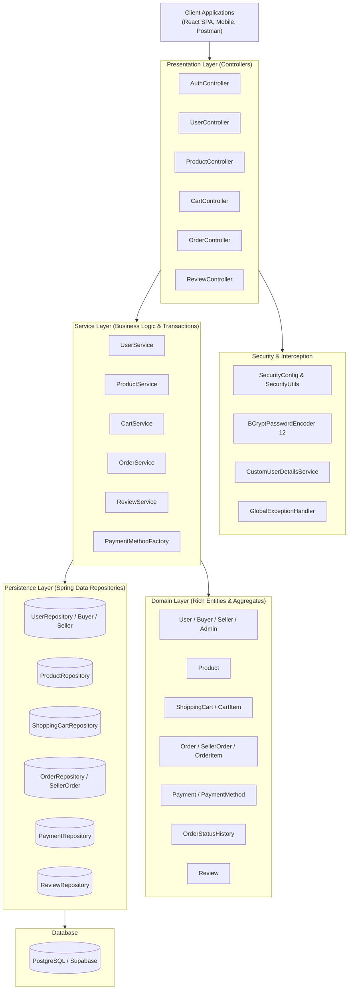
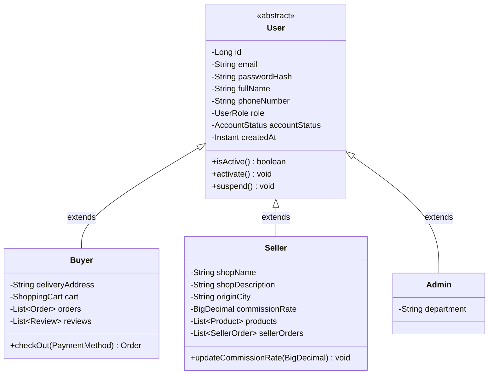
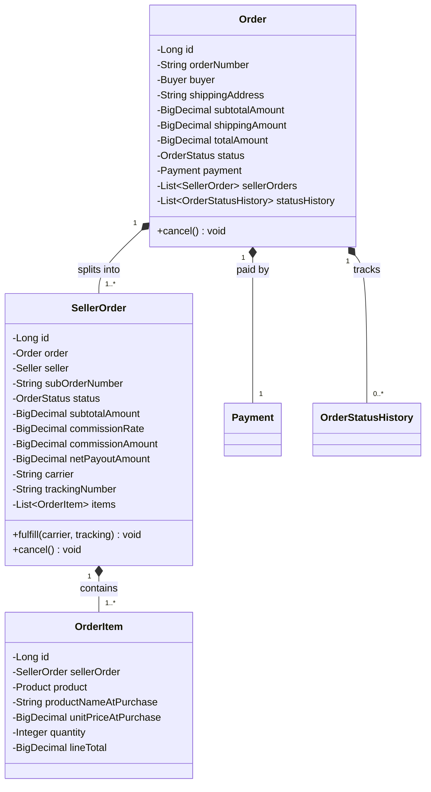
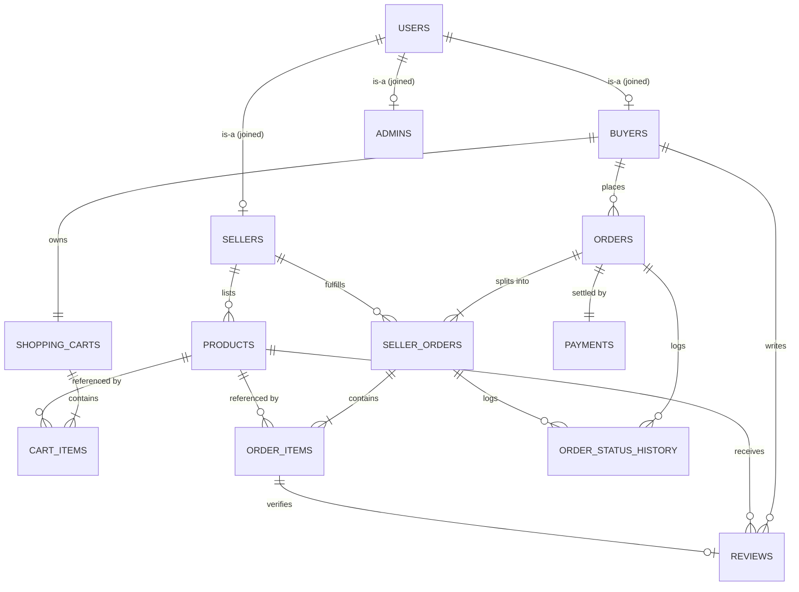
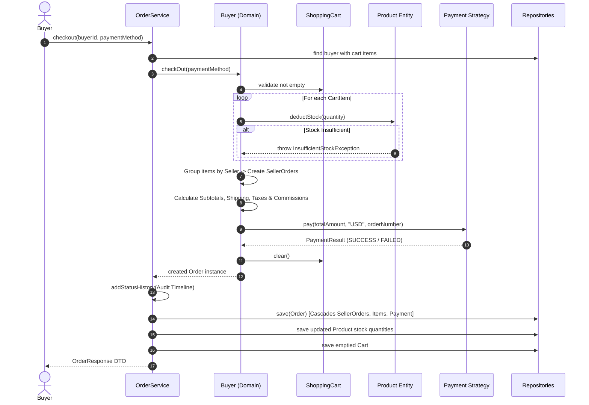
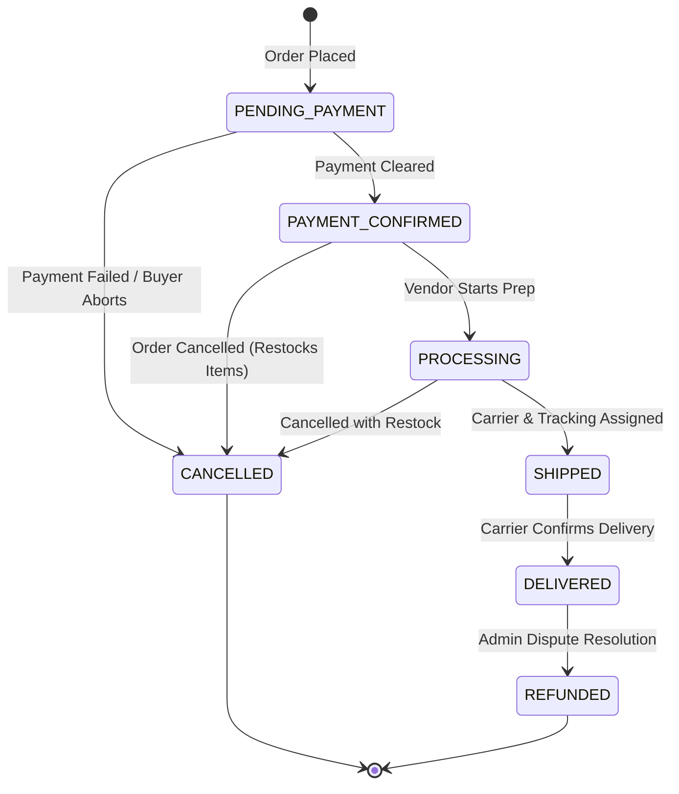
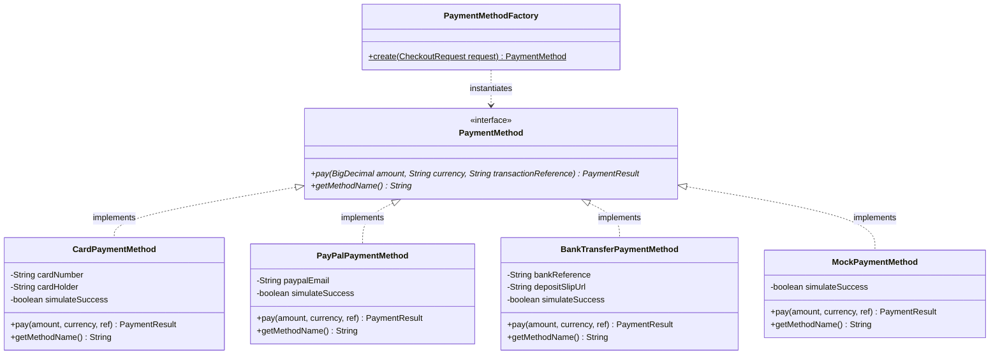

# Serendip Multi-Vendor Marketplace — Comprehensive Backend Architecture & Technical Guide

This document provides a complete technical note and reference for the **Serendip Backend System**, covering architecture, domain models, database schema, design patterns, security, API endpoints, payment systems, and operational configurations.

---

## Table of Contents
1. [Executive Summary & Technology Stack](#1-executive-summary--technology-stack)
2. [Architectural Overview & Layering](#2-architectural-overview--layering)
3. [Domain Model & Entity Relationships](#3-domain-model--entity-relationships)
4. [Database Schema & Migration Strategy](#4-database-schema--migration-strategy)
5. [Multi-Vendor Order Processing & State Machine](#5-multi-vendor-order-processing--state-machine)
6. [Payment Gateway & Strategy Pattern](#6-payment-gateway--strategy-pattern)
7. [Security, Authentication & Authorization (RBAC)](#7-security-authentication--authorization-rbac)
8. [Complete REST API Catalog](#8-complete-rest-api-catalog)
9. [Exception Handling & Validation](#9-exception-handling--validation)
10. [Configuration, Database Pool & Cloud Deployment](#10-configuration-database-pool--cloud-deployment)
11. [Testing Suite & Quality Assurance](#11-testing-suite--quality-assurance)

---

## 1. Executive Summary & Technology Stack

The Serendip backend is an enterprise-grade multi-vendor e-commerce platform developed with **Java 21** and **Spring Boot 3.3.5**. It implements Domain-Driven Design (DDD) principles with rich domain entities, joined-table inheritance, fine-grained role-based security, modular payment strategies, and full audit trailing.

### Core Technologies
- **Language**: Java 21 (LTS) — utilizing modern records, pattern matching, switch expressions, and sealed classes.
- **Framework**: Spring Boot 3.3.5 (Spring Framework 6.1.x).
- **Persistence**: Spring Data JPA & Hibernate 6.5.
- **Database**: PostgreSQL (hosted on Supabase Cloud via transaction pooler or local PostgreSQL).
- **Connection Pool**: HikariCP (tuned for cloud connection pooling).
- **Schema Management**: Flyway 10.x database versioning and migrations.
- **Security**: Spring Security 6.3 with BCrypt (12 rounds) and HTTP Basic/Session RBAC.
- **Validation**: Jakarta Bean Validation (`hibernate-validator`).
- **Build & Packaging**: Apache Maven 3.9+, Docker (multi-stage JRE 21 Alpine).

---

## 2. Architectural Overview & Layering

The application follows a clean 4-tier layered architecture combined with a **Rich Domain Model** (business behaviors reside directly on JPA entities rather than anemic DTOs):



### Layer Responsibilities
- **Presentation (`com.serendip.marketplace.controller`)**: Exposes REST endpoints, binds and validates request bodies (`@Valid`), coordinates with services, and transforms entities into immutable DTO responses (using Java records).
- **Service (`com.serendip.marketplace.service`)**: Orchestrates use cases, enforces cross-entity rules, manages transactional boundaries (`@Transactional`), and handles security ownership checks.
- **Domain (`com.serendip.marketplace.entity`)**: Contains core business rules (e.g. stock reservation in `Product.deductStock()`, multi-vendor grouping in `Buyer.checkOut()`, commission formulas in `SellerOrder.calculateFinancials()`).
- **Persistence (`com.serendip.marketplace.repository`)**: Interfaces extending `JpaRepository` with custom JPQL queries and derived finders.

---

## 3. Domain Model & Entity Relationships

The domain model represents an advanced multi-vendor e-commerce domain.

### 3.1 Inheritance Hierarchy: Users
Serendip uses **Joined-Table Inheritance** (`@Inheritance(strategy = InheritanceType.JOINED)`) for the polymorphic user model:



- **Base Entity `User`**: Holds universal authentication, contact info, and `AccountStatus` (`ACTIVE`, `SUSPENDED`, `PENDING_VERIFICATION`).
- **`Buyer`**: Manages personal shopping cart, shipping addresses, past purchases, and verified reviews.
- **`Seller`**: Owns product catalog entries, customizable platform commission rates (e.g., 10%), origin fulfillment cities, and store analytics.
- **`Admin`**: Platform governance, user activation/suspension, dispute resolution, and system audit log oversight.

---

### 3.2 The Multi-Vendor Order Aggregate

A single buyer checkout may contain products from multiple distinct sellers. Serendip models this using a parent-child order hierarchy:



1. **`Order` (Parent Aggregate)**: Represents the entire transaction initiated by the buyer, encapsulating total payment and global status.
2. **`SellerOrder` (Sub-Order)**: Created per vendor present in the cart. Tracks vendor-specific status (`PROCESSING`, `SHIPPED`, `DELIVERED`), carrier tracking, and financial reconciliation (commission fee deducted, net payout calculated).
3. **`OrderItem` (Snapshot Item)**: Stores immutable snapshots of product name and unit price at the time of purchase (`productNameAtPurchase`, `unitPriceAtPurchase`) to ensure historical integrity even if seller alters prices later.

---

### 3.3 Shopping Cart & Product Catalog

- **`ShoppingCart`**: 1-to-1 association with `Buyer`.
- **`CartItem`**: Encapsulates product reference, quantity, and unit price. Contains domain logic for quantity increment and subtotal calculations.
- **`Product`**: Associated with `Seller`. Supports stock tracking with strict exception guards (`InsufficientStockException`), dual currency attributes (`priceUsd`, `priceLkr`), and Base64/URL image storage.
- **`Review`**: Links `Buyer` and `Product` (with optional `OrderItem` linkage for verified purchases). Rating is restricted between 1 and 5 stars (`InvalidRatingException`).

---

## 4. Database Schema & Migration Strategy

Database migrations are managed via **Flyway** (`classpath:db/migration/V1__init_marketplace_schema.sql`).

### Entity-Relationship Diagram (ERD)



### Key Schema Design Decisions
- **Identity Generation**: BigInt auto-incrementing identity keys (`GENERATED BY DEFAULT AS IDENTITY`).
- **Cascade Deletes**:
  - Removing a cart cascades and deletes all its `cart_items`.
  - Removing a user cascades down to the respective child table (`buyers`, `sellers`, `admins`).
  - Removing an order cascades to its `seller_orders`, `order_items`, `payments`, and `order_status_history`.
- **Indexes**: Strategic B-Tree indexes added on foreign keys (`seller_id`, `buyer_id`, `category`, `cart_id`, `order_id`, `transaction_reference`) for fast queries and joins.

---

## 5. Multi-Vendor Order Processing & State Machine

### 5.1 The Checkout Flow

The checkout workflow executed by `OrderService.checkout(buyerId, paymentMethod)` follows these transactional steps:



---

### 5.2 Order Lifecycle & Permitted State Transitions

Serendip enforces strict state transitions through the `OrderStatus` enum and `OrderService`:



### Transition Enforcement Rules
- **Cancellation Restocking**: When an order transitions to `CANCELLED` (either by the buyer, seller, or admin), `Product.replenishStock()` is invoked automatically for every item in that order, restoring inventory in real time.
- **Independent Vendor Lifecycle**: Each seller can advance their own `SellerOrder` (`PROCESSING` -> `SHIPPED` -> `DELIVERED`) independently of other vendors on the same platform order.
- **Parent Order Status Synchronization**: The parent `Order` status reflects the unified progress of all sub-orders. If all sub-orders are delivered, the parent order is marked `DELIVERED`.

---

### 5.3 Financial Formula Matrix

For each `SellerOrder`, the platform calculates:
$$\text{Line Total} = \text{unitPriceAtPurchase} \times \text{quantity}$$
$$\text{Subtotal} = \sum \text{Line Totals}$$
$$\text{Commission Amount} = \text{Subtotal} \times \left(\frac{\text{commissionRate}}{100}\right)$$
$$\text{Net Payout to Seller} = \text{Subtotal} - \text{Commission Amount}$$

Platform Revenue is the sum of `commissionAmount` across all seller orders plus platform fees.

---

## 6. Payment Gateway & Strategy Pattern

Serendip isolates payment execution logic using the **Strategy Design Pattern**, decoupled by the `PaymentMethod` interface:



### Payment Processing Highlights
1. **Dynamic Instantiation (`PaymentMethodFactory`)**: Evaluates `CheckoutRequest.paymentMethodName()` and constructs the corresponding implementation populated with sensitive credentials (card details, PayPal tokens, bank deposit slip references).
2. **Audit Logging**: Each transaction generates an immutable `Payment` entity recording gateway responses, transaction IDs, statuses (`SUCCESS`, `PENDING`, `FAILED`), and error messages.
3. **Currency Conversion**: Dual currency engine (`CurrencyConverter`, `FixedRateCurrencyConverter`) dynamically converts between USD and Sri Lankan Rupee (LKR) at a fixed exchange rate (1 USD = 305 LKR), allowing pricing in either currency.

---

## 7. Security, Authentication & Authorization (RBAC)

### 7.1 Authentication Architecture
- **Protocol**: HTTP Basic Authentication and Session authentication via Spring Security filter chain.
- **Credentials Validation**: `CustomUserDetailsService` loads `CustomUserPrincipal` directly from `UserRepository`.
- **Password Protection**: Passwords are saved with `BCryptPasswordEncoder(12)`. Plaintext passwords never touch logs or databases.
- **Stateless/Session Hybrid**: APIs support standard HTTP credentials headers on every request or session cookies for web browsers.

### 7.2 Access Control & URL Authorization Matrix

| Endpoint Route | HTTP Method | Permitted Role(s) | Description |
| :--- | :--- | :--- | :--- |
| `/api/v1/auth/**` | `*` | `permitAll()` | Login and public registration |
| `/api/v1/users/buyers` | `POST` | `permitAll()` | Public buyer sign-up |
| `/api/v1/users/sellers` | `POST` | `permitAll()` | Public seller sign-up |
| `/api/v1/products/**` | `GET` | `permitAll()` | Public catalog discovery |
| `/api/v1/reviews/product/**`| `GET` | `permitAll()` | Public reviews reading |
| `/api/v1/carts/**` | `*` | `ROLE_BUYER` | Shopping cart operations |
| `/api/v1/orders/checkout` | `POST` | `ROLE_BUYER` | Place new order |
| `/api/v1/reviews` | `POST` | `ROLE_BUYER` | Post product/order review |
| `/api/v1/products/**` | `POST`, `PUT` | `ROLE_SELLER` | Create/edit products, stock, images |
| `/api/v1/orders/seller/**` | `GET`, `PUT` | `ROLE_SELLER`, `ROLE_ADMIN` | View/fulfill seller sub-orders |
| `/api/v1/users/*/activate` | `PUT` | `ROLE_ADMIN` | Activate user account |
| `/api/v1/users/*/suspend` | `PUT` | `ROLE_ADMIN` | Suspend user account |
| `/api/v1/users/sellers/*/commission` | `PUT` | `ROLE_ADMIN` | Adjust vendor commission rate |
| `/api/v1/orders/admin/**` | `*` | `ROLE_ADMIN` | Platform order analytics, status overrides, CSV exports |

### 7.3 Ownership Verification
In addition to role-based path security, `SecurityUtils.requireOwnershipOrAdmin(ownerId)` ensures that authenticated buyers or sellers can only view or mutate their own resources (e.g. buyers cannot inspect another buyer's cart or order history unless granted `ROLE_ADMIN`).

---

## 8. Complete REST API Catalog

All endpoints are versioned under the `/api/v1` namespace.

### 8.1 Authentication & User Management

```text
POST /api/v1/auth/login
Request:  { "email": "user@example.com", "password": "Password123!" }
Response: AuthResponse (id, email, fullName, role, message)

POST /api/v1/auth/register/buyer
POST /api/v1/users/buyers
Request:  BuyerRegistrationRequest (fullName, email, password, phoneNumber, deliveryAddress)
Response: UserResponse (201 Created)

POST /api/v1/auth/register/seller
POST /api/v1/users/sellers
Request:  SellerRegistrationRequest (fullName, email, password, phoneNumber, shopName, originCity, commissionRate)
Response: UserResponse (201 Created)

GET /api/v1/users/{id}
Response: UserResponse

PUT /api/v1/users/{id}/activate [ADMIN]
PUT /api/v1/users/{id}/suspend  [ADMIN]
Response: UserResponse

PUT /api/v1/users/sellers/{id}/commission [ADMIN]
Request:  { "commissionRate": 12.50 }
Response: UserResponse
```

---

### 8.2 Product Catalog & Inventory

```text
GET /api/v1/products?sellerId={id}&category={category}
Response: List<ProductResponse>

GET /api/v1/products/{id}
Response: ProductResponse

POST /api/v1/products [SELLER]
Request:  ProductCreateRequest (sellerId, name, category, description, priceUsd, stockQuantity, effectiveWeightGrams, imageUrl)
Response: ProductResponse (201 Created)

POST /api/v1/products/lkr [SELLER]
Request:  ProductLkrCreateRequest (price in LKR, converted automatically to USD)
Response: ProductResponse (201 Created)

PUT /api/v1/products/{id}/price [SELLER]
Request:  ProductPriceUpdateRequest (newPriceUsd)
Response: ProductResponse

PUT /api/v1/products/{id}/replenish [SELLER]
Request:  ProductStockReplenishRequest (quantity)
Response: ProductResponse

PUT /api/v1/products/{id}/image [SELLER]
Request:  ProductImageUpdateRequest (imageUrl or data-uri)
Response: ProductResponse

POST /api/v1/products/{id}/image [SELLER] (multipart/form-data)
Param:    file (MultipartFile) -> Auto converts to Base64 Data URI in DB
Response: ProductResponse

PUT /api/v1/products/{id}/activate   [SELLER]
PUT /api/v1/products/{id}/deactivate [SELLER]
Response: ProductResponse
```

---

### 8.3 Shopping Cart

```text
GET /api/v1/carts/{buyerId} [BUYER]
Response: CartResponse (cartId, buyerId, items, totalPrice, totalItems)

POST /api/v1/carts/{buyerId}/items [BUYER]
Request:  CartItemAddRequest (productId, quantity)
Response: CartResponse

PUT /api/v1/carts/{buyerId}/items/{productId} [BUYER]
Request:  CartItemUpdateRequest (quantity)
Response: CartResponse

DELETE /api/v1/carts/{buyerId}/items/{productId} [BUYER]
Response: CartResponse

DELETE /api/v1/carts/{buyerId} [BUYER]
Response: 204 No Content
```

---

### 8.4 Orders, Checkout & Admin Operations

```text
POST /api/v1/orders/checkout [BUYER]
Request:  CheckoutRequest (buyerId, paymentMethodName, cardNumber, cardHolder, paypalEmail, bankReference, depositSlipUrl, simulateSuccess)
Response: OrderResponse (201 Created)

GET /api/v1/orders/{id}
Response: OrderResponse

GET /api/v1/orders/number/{orderNumber}
Response: OrderResponse

GET /api/v1/orders/buyer/{buyerId} [BUYER]
Response: List<OrderResponse>

PUT /api/v1/orders/{id}/cancel
Body:     { "reason": "Buyer requested cancellation" }
Response: OrderResponse

GET /api/v1/orders/seller/{sellerId} [SELLER]
Response: List<SellerOrderResponse>

GET /api/v1/orders/seller-orders/{sellerOrderId} [SELLER]
Response: SellerOrderResponse

PUT /api/v1/orders/seller-orders/{sellerOrderId}/status [SELLER/ADMIN]
Request:  UpdateOrderStatusRequest (newStatus, carrier, trackingNumber, reason)
Response: SellerOrderResponse

PUT /api/v1/orders/seller-orders/{sellerOrderId}/fulfill [SELLER]
Request:  FulfillOrderRequest (carrier, trackingNumber)
Response: SellerOrderResponse

GET /api/v1/orders/admin [ADMIN]
Query:    search, status, sellerId, buyerId
Response: List<OrderResponse>

PUT /api/v1/orders/{id}/admin-status [ADMIN]
Request:  UpdateOrderStatusRequest (newStatus, reason)
Response: OrderResponse

GET /api/v1/orders/admin/sellers/{sellerId} [ADMIN]
Response: AdminSellerOrderStatsResponse (totalSales, platformCommission, netPayout, subOrders)

GET /api/v1/orders/admin/export-csv [ADMIN]
Response: text/csv binary download ("marketplace-orders.csv")

DELETE /api/v1/orders/admin/clear-all [ADMIN]
Response: { "message": "All orders removed successfully", "deletedCount": N }
```

---

### 8.5 Product Reviews

```text
POST /api/v1/reviews [BUYER]
Request:  ReviewCreateRequest (productId, orderItemId, rating [1-5], comment)
Response: ReviewResponse (201 Created)

GET /api/v1/reviews/product/{productId}
Response: List<ReviewResponse>

GET /api/v1/reviews/buyer/{buyerId}
Response: List<ReviewResponse>
```

---

## 9. Exception Handling & Validation

Centralized error handling is handled in `@RestControllerAdvice` class `GlobalExceptionHandler`. Errors return a standardized `ErrorResponse` schema:

```json
{
  "timestamp": "2026-11-22T00:15:30Z",
  "status": 400,
  "error": "Bad Request",
  "message": "Product with id 42 does not have enough stock. Requested: 5, Available: 2.",
  "path": "/api/v1/orders/checkout"
}
```

### Domain Exception Mapping

| Exception Class | HTTP Status | Trigger Condition |
| :--- | :--- | :--- |
| `ResourceNotFoundException` | `404 Not Found` | Entity not found in DB (`Buyer`, `Order`, `Product`) |
| `InsufficientStockException` | `400 Bad Request` | Attempted purchase exceeds current product inventory |
| `InvalidOrderStateException`| `400 Bad Request` | Transition violated (e.g. attempting to ship a cancelled order) |
| `InvalidRatingException` | `400 Bad Request` | Review star rating outside range $[1, 5]$ |
| `BusinessRuleException` | `400 Bad Request` | Cart is empty at checkout, duplicate unique keys |
| `MethodArgumentNotValidException` | `400 Bad Request` | DTO constraint violation (`@NotBlank`, `@Min`, `@Email`) |
| `AccessDeniedException` | `403 Forbidden` | Access to resource belonging to another tenant/user |
| `BadCredentialsException` | `401 Unauthorized` | Invalid email or password during login |

---

## 10. Configuration, Database Pool & Cloud Deployment

### 10.1 Application Properties (`application.properties`)
- **Port**: Configurable via `${SERVER_PORT:${PORT:8080}}`.
- **HikariCP Configuration**: Optimized for Supabase PostgreSQL transaction pooling (port `6543`):
  - `maximum-pool-size=5` (prevents overwhelming cloud pooler limits).
  - `minimum-idle=2`
  - `idle-timeout=30000ms`
  - `max-lifetime=600000ms`
  - `prepareThreshold=0` (disables server-side prepared statements on transaction poolers).
- **Flyway**: `spring.flyway.enabled=true`, baseline-on-migrate enabled.

### 10.2 Docker Multi-Stage Containerization (`Dockerfile`)
The backend is dockerized using a multi-stage build:
1. **Build Stage (`maven:3.9-eclipse-temurin-21`)**: Runs `mvn clean package -DskipTests` to produce the shaded `.jar`.
2. **Runtime Stage (`eclipse-temurin:21-jre-alpine`)**: Minimal alpine container with a non-root system user, exposing port `8080` and executing `java -jar app.jar`.

### 10.3 Cloud Deployment Configuration (`render.yaml`)
Pre-configured for automated cloud deployment on Render or Railway web services with environment variable bindings for `SPRING_DATASOURCE_URL`, `SPRING_DATASOURCE_USERNAME`, and `SPRING_DATASOURCE_PASSWORD`.

---

## 11. Testing Suite & Quality Assurance

The test suite in `src/test/java` provides deep test coverage across all architectural slices:

1. **Unit Tests**:
   - `SerendipDomainModelTest` & `EntityUnitTests`: Validate entity logic, commission math, stock updates, cart behaviors without loading Spring contexts.
   - `PaymentMethodImplementationsTest`: Mocks card, paypal, and bank payment flows.
   - `BCryptPasswordTest`: Verifies password hashing and entropy.
2. **Web Layer Tests (`@WebMvcTest`)**:
   - `AuthControllerTest`, `CartControllerTest`, `ProductControllerTest`, `OrderControllerTest`, `UserControllerTest`, `ReviewControllerTest`: Validate HTTP status codes, JSON serialization, and validation constraints with mocked service dependencies.
3. **Repository Tests (`@DataJpaTest`)**:
   - `DataJpaRepositoryTest`: Tests Flyway migrations, custom JPQL queries, and cascaded associations on an in-memory or PostgreSQL database.
4. **Integration Tests (`@SpringBootTest`)**:
   - `MarketplaceServiceIntegrationTest` & `SecurityIntegrationTest`: Full end-to-end user journeys including registration, catalog creation, cart checkout, multi-vendor order splitting, and fulfillment status updates.
