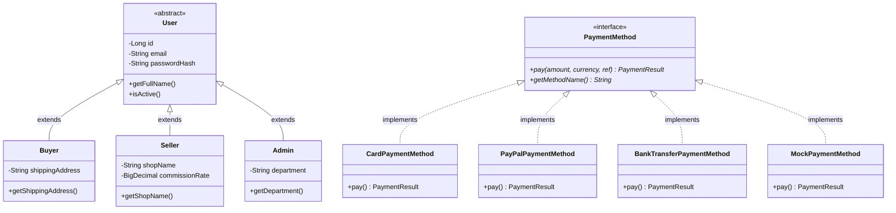
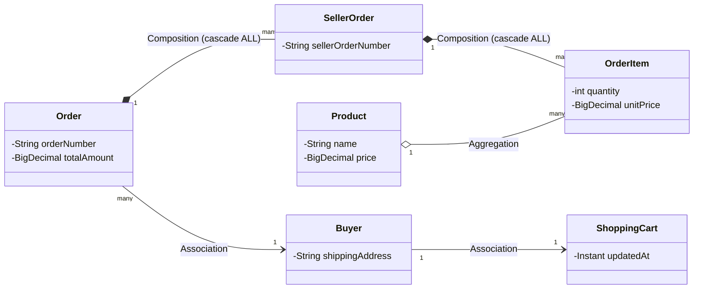

# Serendip Multi-Vendor Marketplace — OOP Concepts Architectural Guide

This document details how every core **Object-Oriented Programming (OOP)** concept is applied within the **Serendip** enterprise application.

---

## Table of Contents
1. [Overview & Architectural Context](#1-overview--architectural-context)
2. [Encapsulation (Data Hiding & State Protection)](#2-encapsulation)
3. [Inheritance (Class & Framework Hierarchies)](#3-inheritance)
4. [Polymorphism (Runtime, Compile-time & Parametric)](#4-polymorphism)
5. [Abstraction (Contracts & Layer Isolation)](#5-abstraction)
6. [Object Relationships: Association, Aggregation & Composition](#6-object-relationships)
7. [OOP-Driven Design Patterns](#7-oop-driven-design-patterns)
8. [Comprehensive OOP Concept Matrix](#8-comprehensive-oop-concept-matrix)

---

## 1. Overview & Architectural Context

The backend is built with **Spring Boot 3** and **Java 21**, adhering to Domain-Driven Design (DDD) principles and pure Object-Oriented patterns.



---

## 2. Encapsulation

**Encapsulation** binds data (attributes) and the operations acting upon them into a single unit, hiding internal state from unauthorized external mutation.

### 2.1 Private Fields & Access Control
All domain models declare instance fields as `private` or `protected`, exposing only vetted getters and setters.

**Example: [`User.java`](src/main/java/com/serendip/marketplace/entity/User.java)**
```java
public abstract class User {
    @Id
    @GeneratedValue(strategy = GenerationType.IDENTITY)
    private Long id;

    @Column(nullable = false, unique = true, length = 150)
    private String email;

    @Column(name = "password_hash", nullable = false, length = 255)
    private String passwordHash;

    // Encapsulated accessor
    public String getEmail() { return email; }
    
    // Controlled mutator with validation
    public void setEmail(String email) {
        if (email == null || !email.contains("@")) {
            throw new IllegalArgumentException("Invalid email format.");
        }
        this.email = email.trim().toLowerCase();
    }
}
```

### 2.2 Rich Domain Model vs. Anemic Model
Rather than exposing raw setters to modify internal state directly from services, entities encapsulate business rules and self-validate invariant states.

**Example: [`Product.java`](src/main/java/com/serendip/marketplace/entity/Product.java)**
```java
// Deducts inventory with business validation
public void deductStock(int quantity) {
    if (quantity <= 0) {
        throw new IllegalArgumentException("Quantity must be positive.");
    }
    if (this.stockQuantity < quantity) {
        throw new InsufficientStockException(
            String.format("Product '%s' has insufficient stock: %d remaining, requested %d",
                this.name, this.stockQuantity, quantity));
    }
    this.stockQuantity -= quantity;
    if (this.stockQuantity == 0) {
        this.active = false; // Encapsulated business side-effect
    }
}

public void replenishStock(int quantity) {
    if (quantity <= 0) {
        throw new IllegalArgumentException("Replenishment quantity must be positive.");
    }
    this.stockQuantity += quantity;
    if (this.stockQuantity > 0) {
        this.active = true;
    }
}
```

### 2.3 Immutable DTOs & Records
Java `record` types are used for Data Transfer Objects, providing complete immutability and thread safety by default:
- [`LoginRequest.java`](src/main/java/com/serendip/marketplace/dto/auth/LoginRequest.java)
- [`CheckoutRequest.java`](src/main/java/com/serendip/marketplace/dto/order/CheckoutRequest.java)
- [`ProductResponse.java`](src/main/java/com/serendip/marketplace/dto/product/ProductResponse.java)

---

## 3. Inheritance

**Inheritance** establishes "is-a" relationships, promoting code reusability and establishing polymorphism.

### 3.1 ORM Joined Table Inheritance
Serendip models user roles using JPA's joined-table inheritance strategy. The base class [`User.java`](src/main/java/com/serendip/marketplace/entity/User.java) holds shared properties (id, email, passwordHash, status, createdAt), while specialized child classes extend it:

```
           ┌──────────────┐
           │     User     │ (abstract base entity)
           └──────┬───────┘
     ┌────────────┼────────────┐
     ▼            ▼            ▼
┌─────────┐  ┌──────────┐  ┌─────────┐
│  Buyer  │  │  Seller  │  │  Admin  │
└─────────┘  └──────────┘  └─────────┘
```

- **Base Class**:
  ```java
  @Entity
  @Table(name = "users")
  @Inheritance(strategy = InheritanceType.JOINED)
  @DiscriminatorColumn(name = "role", discriminatorType = DiscriminatorType.STRING)
  public abstract class User { ... }
  ```
- **Child Classes**:
  - [`Buyer.java`](src/main/java/com/serendip/marketplace/entity/Buyer.java):
    ```java
    @Entity
    @Table(name = "buyers")
    @DiscriminatorValue("BUYER")
    public class Buyer extends User {
        @Column(name = "shipping_address")
        private String shippingAddress;
        ...
    }
    ```
  - [`Seller.java`](src/main/java/com/serendip/marketplace/entity/Seller.java):
    ```java
    @Entity
    @Table(name = "sellers")
    @DiscriminatorValue("SELLER")
    public class Seller extends User {
        @Column(name = "shop_name")
        private String shopName;
        @Column(name = "commission_rate")
        private BigDecimal commissionRate;
        ...
    }
    ```
  - [`Admin.java`](src/main/java/com/serendip/marketplace/entity/Admin.java):
    ```java
    @Entity
    @Table(name = "admins")
    @DiscriminatorValue("ADMIN")
    public class Admin extends User {
        @Column(name = "department")
        private String department;
        ...
    }
    ```

### 3.2 Exception Hierarchy Inheritance
Domain exceptions inherit from a common custom runtime exception:

```
java.lang.Throwable
  └── java.lang.Exception
        └── java.lang.RuntimeException
              └── BusinessRuleException
                    ├── InsufficientStockException
                    ├── InvalidOrderStateException
                    ├── InvalidRatingException
                    └── ResourceNotFoundException
```

This enables the [`GlobalExceptionHandler.java`](src/main/java/com/serendip/marketplace/exception/GlobalExceptionHandler.java) to catch `BusinessRuleException` polymorphically or handle specific subclasses with custom HTTP status codes.

---

## 4. Polymorphism

**Polymorphism** ("many forms") allows objects of different classes to respond to the same message/method call in their own specialized way.

### 4.1 Subtype / Dynamic Polymorphism (Runtime Polymorphism)
Subtype polymorphism is heavily utilized in the payment subsystem through the [`PaymentMethod`](src/main/java/com/serendip/marketplace/payment/PaymentMethod.java) interface:

```java
public interface PaymentMethod {
    PaymentResult pay(BigDecimal amount, String currency, String orderReference);
    String getMethodName();
}
```

Concrete implementations provide their own execution logic:
- [`CardPaymentMethod`](src/main/java/com/serendip/marketplace/payment/CardPaymentMethod.java): Validates card numbers and cvv.
- [`PayPalPaymentMethod`](src/main/java/com/serendip/marketplace/payment/PayPalPaymentMethod.java): Processes PayPal digital transactions.
- [`BankTransferPaymentMethod`](src/main/java/com/serendip/marketplace/payment/BankTransferPaymentMethod.java): Generates deposit reference numbers.
- [`MockPaymentMethod`](src/main/java/com/serendip/marketplace/payment/MockPaymentMethod.java): Fast automated test payment.

In [`OrderService.java`](src/main/java/com/serendip/marketplace/service/OrderService.java), the checkout workflow processes payments uniformly without knowing the concrete class:
```java
PaymentMethod paymentMethod = PaymentMethodFactory.create(request);

// Polymorphic invocation resolved dynamically at runtime:
PaymentResult result = paymentMethod.pay(totalAmount, currency, orderNumber);
```

### 4.2 Compile-Time Polymorphism (Method Overloading)
Compile-time polymorphism occurs when multiple methods in the same class share a name but differ in parameter count or types.

1. **Overloaded Interface Method in [`PaymentMethod.java`](src/main/java/com/serendip/marketplace/payment/PaymentMethod.java)**:
   ```java
   PaymentResult pay(BigDecimal amount, String currency, String orderReference);

   default PaymentResult pay(String orderReference, BigDecimal amount, String currencyCode) {
       return pay(amount, currencyCode, orderReference);
   }
   ```
2. **Overloaded Factory Methods in [`Product.java`](src/main/java/com/serendip/marketplace/entity/Product.java)**:
   ```java
   public static Product createInLkr(String name, BigDecimal priceInLkr, int stock, Seller seller) {
       return createInLkr(name, "General", "", priceInLkr, stock, seller, 100);
   }

   public static Product createInLkr(String name, String category, String description,
                                     BigDecimal priceInLkr, int stock, Seller seller, int weightGrams) { ... }
   ```
3. **Overloaded Entity Constructors in [`Order.java`](src/main/java/com/serendip/marketplace/entity/Order.java)**:
   ```java
   public Order(Buyer buyer) { ... }
   public Order(String orderNumber, Buyer buyer, String shippingAddress, String paymentMethodName) { ... }
   ```

### 4.3 Parametric Polymorphism (Generics)
Parametric polymorphism is used with generic interfaces:
- **Spring Data Repositories**:
  ```java
  public interface UserRepository extends JpaRepository<User, Long> { ... }
  public interface OrderRepository extends JpaRepository<Order, Long> { ... }
  ```
  `JpaRepository<T, ID>` handles CRUD operations generically for any entity `T` and identifier type `ID`.
- **API Payloads**:
  `ResponseEntity<ApiResponse<T>>` wraps arbitrary response payloads inside standard HTTP structures.

---

## 5. Abstraction

**Abstraction** focuses on essential characteristics while concealing low-level implementation mechanics.

### 5.1 Interfaces as Functional Contracts
- **[`PaymentMethod.java`](src/main/java/com/serendip/marketplace/payment/PaymentMethod.java)**:
  Exposes `pay(...)` and `getMethodName()`. Callers do not know whether communication occurs over HTTPS, a banking gateway, or simulated memory.
- **[`CurrencyConverter.java`](src/main/java/com/serendip/marketplace/payment/CurrencyConverter.java)**:
  Defines currency conversion logic. Implemented by [`FixedRateCurrencyConverter.java`](src/main/java/com/serendip/marketplace/payment/FixedRateCurrencyConverter.java), abstracting away exchange rate calculations.

### 5.2 Abstract Classes
The [`User.java`](src/main/java/com/serendip/marketplace/entity/User.java) class is declared `abstract`:
```java
public abstract class User { ... }
```
You cannot instantiate a generic "User" directly with `new User()`; a user must always be a concrete role (`Buyer`, `Seller`, or `Admin`).

### 5.3 Architectural Layer Abstraction
Each architectural tier interacts only through higher-level abstractions:
```
[ Controllers ]  ──> [ Services ]       ──> [ Repositories ]  ──> [ Database ]
(HTTP Handling)     (Business Logic)        (Data Persistence)     (PostgreSQL)
```
- **Controller Layer** abstracts HTTP protocol, status codes, and JSON serialization.
- **Service Layer** abstracts transactional consistency, currency conversion, and validations.
- **Repository Layer** abstracts raw SQL queries using Spring Data JPA method specifications.

---

## 6. Object Relationships

OOP models relationships between objects based on coupling and ownership lifecycles.



### 6.1 Composition ("Part-of" with strict lifecycle binding)
In composition, the child cannot exist without the parent. If the parent is deleted, the children are destroyed (`CascadeType.ALL, orphanRemoval = true`).

1. **[`Order.java`](src/main/java/com/serendip/marketplace/entity/Order.java) ➔ `SellerOrder` ➔ `OrderItem`**:
   ```java
   // In Order.java
   @OneToMany(mappedBy = "order", cascade = CascadeType.ALL, orphanRemoval = true)
   private List<SellerOrder> sellerOrders = new ArrayList<>();

   // In SellerOrder.java
   @OneToMany(mappedBy = "sellerOrder", cascade = CascadeType.ALL, orphanRemoval = true)
   private List<OrderItem> items = new ArrayList<>();
   ```
   An `OrderItem` or `SellerOrder` has no meaning or existence outside its root purchase `Order`.

2. **`Order` ➔ `OrderStatusHistory`**:
   Audit log entries tracking status transitions are lifecycle-bound to that order.

### 6.2 Aggregation ("Has-a" with independent lifecycles)
In aggregation, child objects can exist independently of the container.

1. **[`Seller.java`](src/main/java/com/serendip/marketplace/entity/Seller.java) ➔ [`Product.java`](src/main/java/com/serendip/marketplace/entity/Product.java)**:
   A seller owns products. If a product is detached or a seller's shop is deactivated, the product entity records and historical order references remain intact.
2. **`Product` ➔ `Review`**:
   Customer reviews aggregate onto a catalog product.

### 6.3 Association ("Uses-a" relationship)
Objects communicate across boundaries without containment.

1. **`Buyer` ➔ `ShoppingCart`**:
   One-to-One bidirectional association connecting a customer to their shopping cart session.
2. **`Order` ➔ `Payment`**:
   One-to-One association tracking the transactional financial record for a customer order.

---

## 7. OOP-Driven Design Patterns

The codebase translates OOP concepts into established Gang of Four (GoF) design patterns:

### 7.1 Strategy Pattern
- **Purpose**: Defines a family of interchangeable algorithms.
- **Code**: [`PaymentMethod.java`](src/main/java/com/serendip/marketplace/payment/PaymentMethod.java) serves as the strategy interface. The checkout algorithm accepts any `PaymentMethod` strategy (`Card`, `PayPal`, `BankTransfer`, `Mock`) and executes payment without code modification (Open/Closed Principle).

### 7.2 Factory Method Pattern
- **Purpose**: Encapsulates object creation logic behind a centralized factory.
- **Code**: [`PaymentMethodFactory.java`](src/main/java/com/serendip/marketplace/payment/PaymentMethodFactory.java):
  ```java
  public final class PaymentMethodFactory {
      private PaymentMethodFactory() {} // Prevents direct instantiation

      public static PaymentMethod create(CheckoutRequest request) {
          String normalized = request.paymentMethodName().toUpperCase();
          return switch (normalized) {
              case "CARD", "CARD_PAYMENT" -> new CardPaymentMethod(...);
              case "PAYPAL" -> new PayPalPaymentMethod(...);
              case "BANK", "BANK_TRANSFER" -> new BankTransferPaymentMethod(...);
              default -> new MockPaymentMethod(...);
          };
      }
  }
  ```

### 7.3 Dependency Injection & Inversion of Control (IoC)
- **Purpose**: High-level modules do not instantiate low-level components; both depend on abstractions (Dependency Inversion Principle).
- **Code**: Service constructors declare interface dependencies injected by Spring's IoC container:
  ```java
  @Service
  public class OrderService {
      private final OrderRepository orderRepository;
      private final ProductRepository productRepository;
      private final CurrencyConverter currencyConverter;

      public OrderService(OrderRepository orderRepository,
                          ProductRepository productRepository,
                          CurrencyConverter currencyConverter) {
          this.orderRepository = orderRepository;
          this.productRepository = productRepository;
          this.currencyConverter = currencyConverter;
      }
  }
  ```

---

## 8. Comprehensive OOP Concept Matrix

| OOP Principle | Core Mechanism in Serendip | Key Source Files |
| :--- | :--- | :--- |
| **Encapsulation** | Private instance variables, getter/setter validation, domain state manipulation (`deductStock`, `calculateTotal`), immutable records | [`Product.java`](src/main/java/com/serendip/marketplace/entity/Product.java)<br>[`User.java`](src/main/java/com/serendip/marketplace/entity/User.java)<br>[`Order.java`](src/main/java/com/serendip/marketplace/entity/Order.java) |
| **Inheritance** | JPA Joined-table inheritance (`User` ➔ `Buyer`, `Seller`, `Admin`), Exception hierarchy (`RuntimeException` ➔ `BusinessRuleException`) | [`User.java`](src/main/java/com/serendip/marketplace/entity/User.java)<br>[`Buyer.java`](src/main/java/com/serendip/marketplace/entity/Buyer.java)<br>[`BusinessRuleException.java`](src/main/java/com/serendip/marketplace/exception/BusinessRuleException.java) |
| **Runtime Polymorphism** | Interface implementation, dynamic dispatch on `PaymentMethod.pay(...)` & `CurrencyConverter.convert(...)` | [`PaymentMethod.java`](src/main/java/com/serendip/marketplace/payment/PaymentMethod.java)<br>[`CardPaymentMethod.java`](src/main/java/com/serendip/marketplace/payment/CardPaymentMethod.java)<br>[`OrderService.java`](src/main/java/com/serendip/marketplace/service/OrderService.java) |
| **Compile-time Polymorphism** | Method overloading in constructors (`Order`, `Product`), factory helpers (`createInLkr`), default interface methods | [`Product.java`](src/main/java/com/serendip/marketplace/entity/Product.java)<br>[`PaymentMethod.java`](src/main/java/com/serendip/marketplace/payment/PaymentMethod.java) |
| **Parametric Polymorphism** | Generic repository abstractions `JpaRepository<T, ID>`, `Optional<T>`, `ResponseEntity<T>` | [`UserRepository.java`](src/main/java/com/serendip/marketplace/repository/UserRepository.java)<br>[`ProductRepository.java`](src/main/java/com/serendip/marketplace/repository/ProductRepository.java) |
| **Abstraction** | Contractual interfaces (`PaymentMethod`, `CurrencyConverter`), abstract classes (`User`), layered architectural separation | [`PaymentMethod.java`](src/main/java/com/serendip/marketplace/payment/PaymentMethod.java)<br>[`User.java`](src/main/java/com/serendip/marketplace/entity/User.java)<br>[`CurrencyConverter.java`](src/main/java/com/serendip/marketplace/payment/CurrencyConverter.java) |
| **Composition** | Strong ownership with `cascade = CascadeType.ALL, orphanRemoval = true` (`Order` owns `SellerOrder` owns `OrderItem`) | [`Order.java`](src/main/java/com/serendip/marketplace/entity/Order.java)<br>[`SellerOrder.java`](src/main/java/com/serendip/marketplace/entity/SellerOrder.java) |
| **Aggregation** | Standalone entity relationships (`Seller` has `Product`s, `Product` has `Review`s) | [`Seller.java`](src/main/java/com/serendip/marketplace/entity/Seller.java)<br>[`Product.java`](src/main/java/com/serendip/marketplace/entity/Product.java) |
| **Association** | Navigational references across domains (`Buyer` ➔ `ShoppingCart`, `Order` ➔ `Payment`) | [`Buyer.java`](src/main/java/com/serendip/marketplace/entity/Buyer.java)<br>[`Order.java`](src/main/java/com/serendip/marketplace/entity/Order.java) |
