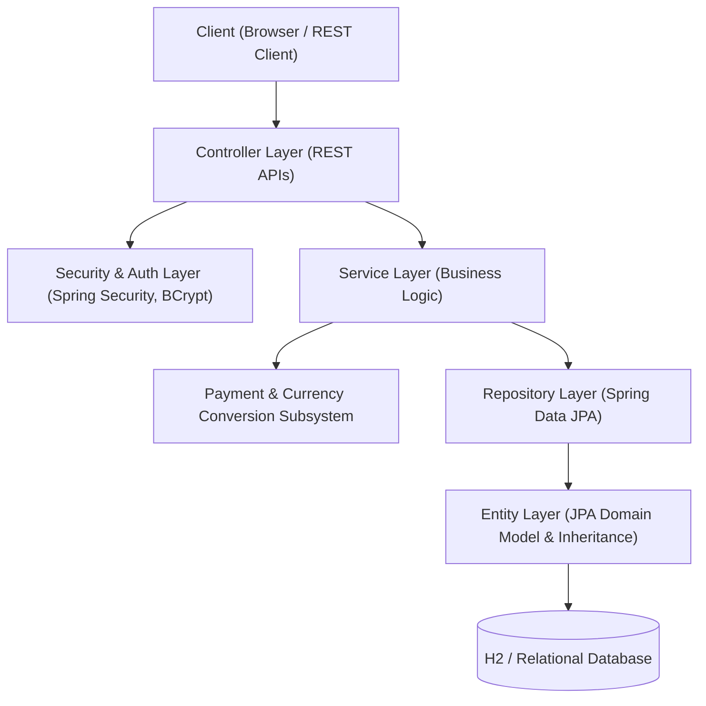

# Serendip Marketplace - Complete Java Codebase Documentation (සම්පූර්ණ ජාවා කේත ලේඛනගත කිරීම)

මෙම ලේඛනය මඟින් **Serendip Marketplace** ව්‍යාපෘතියේ අඩංගු සියලුම Java Classes, Sub-classes, Interfaces, Enums, DTOs සහ Exceptions පිළිබඳව, ඒවායේ Attributes (ගුණාංග), Behaviours/Methods (හැසිරීම්/ක්‍රම) සහ ඒවායින් සිදු වන කාර්යයන් (Exact Purpose/Functionality) ඉංග්‍රීසි සහ සිංහල භාෂා ද්විත්වයෙන්ම විස්තර කර ඇත.

---

## Architecture Overview (ගෘහ නිර්මාණ ශිල්පය පිළිබඳ දළ විශ්ලේෂණය)

Serendip යනු Spring Boot 3.x සහ Java 17+ පාදක කරගත් Multi-Vendor E-Commerce Platform එකකි. එහි ගෘහ නිර්මාණ ශිල්පය ස්ථර 10 කින් (10 Architectural Layers) සමන්විත වේ:

---

## 1. Core Application & Configuration (මූලික යෙදුම සහ වින්‍යාසය)

### 1.1 `SerendipApplication`
- **File**: `com.serendip.marketplace.SerendipApplication`
- **Type**: Main Entry Point Class (`@SpringBootApplication`)
- **English**: Bootstraps the Serendip Spring Boot application, component scanning, auto-configuration, and embedded Tomcat server.
- **සිංහල**: Spring Boot යෙදුම ආරම්භ කරන ප්‍රධාන class එකයි. මෙයින් Spring container එක, component scanning සහ embedded Tomcat web server එක පණගන්වයි.
- **Attributes**: None (Stateless).
- **Behaviours / Methods**:
  - `public static void main(String[] args)`: Java main method එක. `SpringApplication.run(...)` කැඳවා මුළු application එකම boot කරයි.

---

### 1.2 `DataInitializer`
- **File**: `com.serendip.marketplace.config.DataInitializer`
- **Type**: Configuration & Seeding Class (`@Component`, `implements CommandLineRunner`)
- **English**: Seeds baseline administrative, buyer, and seller accounts along with sample marketplace products into the database on startup.
- **සිංහල**: Application එක start වන විට පද්ධතියට අවශ්‍ය මූලික Buyer, Seller, Admin ගිණුම් සහ සාම්පල භාණ්ඩ (Products) database එකට ඇතුළත් (seed) කරයි.
- **Attributes**:
  - `UserRepository userRepository`: පරිශීලක තොරතුරු සුරැකීමට.
  - `BuyerRepository buyerRepository`: Buyer ගිණුම් හැසිරවීමට.
  - `SellerRepository sellerRepository`: Seller ගිණුම් හැසිරවීමට.
  - `ProductRepository productRepository`: Products සුරැකීමට.
  - `PasswordEncoder passwordEncoder`: මුරපද BCrypt මගින් hash කිරීමට.
- **Behaviours / Methods**:
  - `public void run(String... args)`: Startup එකේදී ස්වයංක්‍රීයව ධාවනය වී default admin, sellers (Ceylon Teas, Spice Garden), buyers, සහ products inject කරයි.

---

## 2. Entity & Domain Model Layer (OOP Inheritance & JPA Entities)

### 2.1 `User` (Abstract Base Class - මූලික වියුක්ත පන්තිය)
- **File**: `com.serendip.marketplace.entity.User`
- **Type**: `@Entity`, `@Inheritance(strategy = InheritanceType.JOINED)`, `abstract class`
- **English**: Base class for all actors in the platform. Implements authentication state, common profile fields, password hashing verification, and account status controls.
- **සිංහල**: පද්ධතියේ සියලුම පරිශීලකයින් සඳහා මූලික වියුක්ත පන්තියයි (Base class). Buyer, Seller, Admin යන සියලු දෙනා මේ පන්තියෙන් උරුම කරගනී (Inheritance).
- **Attributes**:
  - `Long id`: Primary Key.
  - `String fullName`: පරිශීලකයාගේ සම්පූර්ණ නම.
  - `String email`: පිවිසුම් ඊමේල් ලිපිනය (Unique).
  - `String passwordHash`: BCrypt මඟින් hash කළ මුරපදය.
  - `String phoneNumber`: දුරකථන අංකය.
  - `AccountStatus accountStatus`: ගිණුමේ තත්ත්වය (ACTIVE, SUSPENDED, LOCKED).
  - `boolean loggedIn` (`@Transient`): පරිශීලකයා ලොග් වී ඇත්දැයි බැලීමේ තාවකාලික flag එක.
  - `Instant createdAt`: ගිණුම සෑදූ වේලාව.
- **Behaviours / Methods**:
  - `public abstract UserRole getRole()`: උප පන්ති (subclasses) විසින් implement කළ යුතු වියුක්ත ක්‍රමයකි.
  - `public boolean checkPassword(String candidateHash)`: ලබා දුන් මුරපද hash එක ගැලපේදැයි පරීක්ෂා කරයි.
  - `public void updatePassword(String newPasswordHash)`: නව මුරපදය යාවත්කාලීන කරයි.
  - `public void activate()`: ගිණුම ACTIVE තත්ත්වයට පත් කරයි.
  - `public void suspend()`: ගිණුම SUSPENDED කරයි; active session ඉවත් කරයි.
  - `public void lock()`: ගිණුම LOCKED කරයි; active session ඉවත් කරයි.
  - `public void login()`: ගිණුම ACTIVE නම් login flag එක true කරයි.
  - `public void logout()`: session එක අවසන් කරයි (loggedIn = false).
  - Getters / Setters (නම, ඊමේල් format validate කරමින්).

---

### 2.2 `Admin` (Subclass of User - උප පන්තිය)
- **File**: `com.serendip.marketplace.entity.Admin`
- **Type**: `@Entity`, `public class Admin extends User`
- **English**: Subclass representing platform administrators who oversee users, manage seller commission rates, and track marketplace revenue.
- **සිංහල**: `User` පන්තියෙන් උරුම වූ උප පන්තියකි. පද්ධතියේ පරිපාලකයින් නියෝජනය කරයි. පරිශීලකයින් suspend/activate කිරීම සහ Seller commission අනුපාත පාලනය කිරීම සිදු කරයි.
- **Attributes**:
  - `String department`: පරිපාලකයා අයත් දෙපාර්තමේන්තුව (default: "Operations").
- **Behaviours / Methods**:
  - `public UserRole getRole()`: returns `UserRole.ADMIN`.
  - `public void suspendUser(User user)`: පරිශීලකයෙකුගේ ගිණුම අත්හිටුවයි (suspend).
  - `public void activateUser(User user)`: අත්හිටවූ ගිණුමක් නැවත සක්‍රීය කරයි (activate).
  - `public List<User> listAllUsers(List<User> registry)`: සියලු පරිශීලකයින්ගේ unmodifiable list එකක් ලබා දෙයි.
  - `public void setSellerCommissionRate(Seller seller, BigDecimal rate)`: Seller කෙනෙකු සඳහා platform commission ප්‍රතිශතය සකසයි (0% - 100%).
  - `public BigDecimal calculateCommission(SellerOrder subOrder)`: උප ඇණවුමක commission මුදල ගණනය කරයි.
  - `public BigDecimal calculateTotalCommission(Order order)`: සම්පූර්ණ order එකකින් ලැබෙන මුළු commission එක ගණනය කරයි.
  - `public BigDecimal calculateTotalCommission(List<Order> orders)`: ඇණවුම් රාශියක මුළු commission එක ගණනය කරයි.

---

### 2.3 `Buyer` (Subclass of User - උප පන්තිය)
- **File**: `com.serendip.marketplace.entity.Buyer`
- **Type**: `@Entity`, `public class Buyer extends User`
- **English**: Subclass representing customer buyers who browse products, manage an active cart, place orders, make payments, and write product reviews.
- **සිංහල**: `User` ගෙන් පැවත එන පාරිභෝගික පන්තියයි. කරත්තයට භාණ්ඩ එකතු කිරීම, checkout කිරීම, ඇණවුම් තැබීම සහ reviews ලිවීම සිදු කරයි.
- **Attributes**:
  - `String deliveryAddress`: භාණ්ඩ භාරදිය යුතු ලිපිනය.
  - `ShoppingCart cart` (`@OneToOne`): Buyer සතු සාප්පු සවාරි කරත්තය.
  - `List<Order> orders` (`@OneToMany`): Buyer විසින් තැබූ ඇණවුම් ලැයිස්තුව.
  - `List<Review> reviews` (`@OneToMany`): Buyer විසින් ලියන ලද reviews.
- **Behaviours / Methods**:
  - `public UserRole getRole()`: returns `UserRole.BUYER`.
  - `public ShoppingCart getCart()`: Buyer සතු කරත්තය ලබා දෙයි (නැත්නම් අලුතින් සාදයි).
  - `public void addToCart(Product product, int quantity)`: භාණ්ඩයක් කරත්තයට එක් කරයි.
  - `public void removeFromCart(Product product)`: භාණ්ඩයක් කරත්තයෙන් ඉවත් කරයි.
  - `public void clearCart()`: කරත්තය සම්පූර්ණයෙන්ම හිස් කරයි.
  - `public Order checkout(PaymentMethod paymentMethod)`: කරත්තයේ ඇති භාණ්ඩ සඳහා ගෙවීම් කර නව Order එකක් සාදයි.
  - `public Review writeReview(Product product, int rating, String comment)`: භාණ්ඩයකට තරු ලකුණු (1-5) සහ අදහස් ලබා දෙයි.

---

### 2.4 `Seller` (Subclass of User - උප පන්තිය)
- **File**: `com.serendip.marketplace.entity.Seller`
- **Type**: `@Entity`, `public class Seller extends User`
- **English**: Subclass representing vendors who list products, replenish inventory, manage seller sub-orders, and monitor revenue/earnings.
- **සිංහල**: `User` ගෙන් පැවත එන වෙළෙන්දා (Vendor/Seller) නියෝජනය කරන පන්තියයි. භාණ්ඩ විකිණීමට දැමීම, තොග යාවත්කාලීන කිරීම, සහ තම විකුණුම් මුදල් පරීක්ෂා කිරීම සිදු කරයි.
- **Attributes**:
  - `String shopName`: කඩයේ නම (Unique).
  - `String originCity`: වෙළෙන්දාගේ නගරය/ප්‍රදේශය.
  - `String bankAccount`: ගෙවීම් බැර කළ යුතු බැංකු ගිණුම් විස්තර.
  - `BigDecimal commissionRate`: Platform එකට ගෙවිය යුතු commission ප්‍රතිශතය (default: 10.00%).
  - `List<Product> products` (`@OneToMany`): විකිණීමට ඇති භාණ්ඩ ලැයිස්තුව.
  - `List<SellerOrder> sellerOrders` (`@OneToMany`): Seller වෙත පැමිණි sub-orders ලැයිස්තුව.
- **Behaviours / Methods**:
  - `public UserRole getRole()`: returns `UserRole.SELLER`.
  - `public Product createProduct(String name, String desc, BigDecimal price, int stock)`: අලුත් භාණ්ඩයක් list කරයි.
  - `public void updatePrice(Product product, BigDecimal newPrice)`: භාණ්ඩයක මිල වෙනස් කරයි.
  - `public void replenishStock(Product product, int additionalQuantity)`: භාණ්ඩ තොග වැඩි කරයි.
  - `public void addOrder(SellerOrder subOrder)`: ලැබුණු sub-order එකක් එකතු කරයි.
  - `public BigDecimal getTotalSalesRevenue()`: සම්පූර්ණ විකුණුම් ආදායම ගණනය කරයි.
  - `public BigDecimal getNetEarnings()`: Platform commission එක අඩු කිරීමෙන් පසු Seller ට හිමි ශුද්ධ ආදායම ගණනය කරයි.

---

### 2.5 `Product`
- **File**: `com.serendip.marketplace.entity.Product`
- **Type**: `@Entity`, `public class Product`
- **English**: Represents an item for sale in the marketplace, containing price, stock inventory, seller association, and buyer reviews.
- **සිංහල**: වෙළෙඳපොළේ විකිණීමට තබා ඇති භාණ්ඩයක් නියෝජනය කරයි. මිල, තොග ප්‍රමාණය, අදාළ වෙළෙන්දා සහ reviews අඩංගු වේ.
- **Attributes**:
  - `Long id`: Primary Key.
  - `String name`: භාණ්ඩයේ නම.
  - `String description`: භාණ්ඩය පිළිබඳ විස්තරය.
  - `BigDecimal price`: භාණ්ඩයේ මිල (USD).
  - `int stockQuantity`: ඉතිරිව ඇති තොග ප්‍රමාණය.
  - `Seller seller` (`@ManyToOne`): මෙම භාණ්ඩය අයිති වෙළෙන්දා.
  - `List<Review> reviews` (`@OneToMany`): පාරිභෝගික reviews ලැයිස්තුව.
  - `Instant createdAt`: භාණ්ඩය ඇතුළත් කළ දිනය සහ වේලාව.
- **Behaviours / Methods**:
  - `public void reduceStock(int quantity)`: මිලදී ගැනීමේදී තොග ප්‍රමාණය අඩු කරයි (Insufficient stock නම් Exception විසි කරයි).
  - `public void replenishStock(int quantity)`: තොග ප්‍රමාණය වැඩිකරයි.
  - `public void updatePrice(BigDecimal newPrice)`: මිල යාවත්කාලීන කරයි.
  - `public double calculateAverageRating()`: සියලු reviews වල සාමාන්‍ය තරු අගය (Average rating) ගණනය කරයි.
  - `public boolean isInStock(int quantity)`: ප්‍රමාණවත් තොග තිබේදැයි බලයි.

---

### 2.6 `ShoppingCart`
- **File**: `com.serendip.marketplace.entity.ShoppingCart`
- **Type**: `@Entity`, `public class ShoppingCart`
- **English**: Represents a buyer's persistent shopping basket holding multiple item selections before checkout.
- **සිංහල**: Buyer කෙනෙකු මිලදී ගැනීමට පෙර තෝරාගත් භාණ්ඩ තබා ගන්නා කරත්තයයි.
- **Attributes**:
  - `Long id`: Primary Key.
  - `Buyer buyer` (`@OneToOne`): කරත්තයේ අයිතිකරු.
  - `List<CartItem> items` (`@OneToMany`, cascade ALL, orphanRemoval): කරත්තයේ ඇති භාණ්ඩ අයිතම.
  - `Instant updatedAt`: කරත්තය අවසන් වරට වෙනස් කළ වේලාව.
- **Behaviours / Methods**:
  - `public void addItem(Product product, int quantity)`: අයිතමයක් එක් කරයි (දැනටමත් තිබේ නම් ප්‍රමාණය වැඩි කරයි).
  - `public void removeItem(Product product)`: අයිතමයක් ඉවත් කරයි.
  - `public void updateQuantity(Product product, int quantity)`: භාණ්ඩයක ප්‍රමාණය වෙනස් කරයි (0 නම් ඉවත් කරයි).
  - `public void clear()`: කරත්තය හිස් කරයි.
  - `public BigDecimal calculateTotalPrice()`: කරත්තයේ ඇති සියලු භාණ්ඩවල මුළු එකතුව ගණනය කරයි.
  - `public int getTotalItemCount()`: කරත්තයේ ඇති මුළු භාණ්ඩ ගණන ගණනය කරයි.
  - `public boolean isEmpty()`: කරත්තය හිස්දැයි පරීක්ෂා කරයි.

---

### 2.7 `CartItem`
- **File**: `com.serendip.marketplace.entity.CartItem`
- **Type**: `@Entity`, `public class CartItem`
- **English**: Represents a single product entry and requested quantity inside a shopping cart.
- **සිංහල**: කරත්තයක් තුළ ඇති තනි භාණ්ඩයක් සහ එහි ප්‍රමාණය නියෝජනය කරයි.
- **Attributes**:
  - `Long id`: Primary Key.
  - `ShoppingCart cart` (`@ManyToOne`): අදාළ කරත්තය.
  - `Product product` (`@ManyToOne`): අදාළ භාණ්ඩය.
  - `int quantity`: මිලදී ගැනීමට අවශ්‍ය ප්‍රමාණය.
  - `BigDecimal unitPrice`: එම අවස්ථාවේ ඒකක මිල.
- **Behaviours / Methods**:
  - `public BigDecimal calculateSubtotal()`: ඒකක මිල × ප්‍රමාණය ගණනය කරයි.
  - `public void incrementQuantity(int delta)`: ප්‍රමාණය වැඩි කරයි.
  - `public void decrementQuantity(int delta)`: ප්‍රමාණය අඩු කරයි.

---

### 2.8 `Order`
- **File**: `com.serendip.marketplace.entity.Order`
- **Type**: `@Entity`, `public class Order`
- **English**: Central order entity encapsulating the customer's purchase, overall payment, delivery details, line items, and seller sub-orders.
- **සිංහල**: පාරිභෝගිකයාගේ සම්පූර්ණ මිලදී ගැනීම නියෝජනය කරන ප්‍රධාන Order entity එකයි. ගෙවීම්, ලිපිනය, භාණ්ඩ ලැයිස්තුව සහ අදාළ වෙළෙන්දන්ගේ Sub-orders මෙහි අඩංගු වේ.
- **Attributes**:
  - `Long id`: Primary Key.
  - `String orderNumber`: අද්විතීය ඇණවුම් අංකය (උදා: ORD-UUID).
  - `Buyer buyer` (`@ManyToOne`): ඇණවුම තැබූ Buyer.
  - `Instant orderDate`: ඇණවුම තැබූ දිනය/වේලාව.
  - `OrderStatus status`: ඇණවුමේ තත්ත්වය (PENDING, PAID, PROCESSING, SHIPPED, DELIVERED, CANCELLED).
  - `BigDecimal totalAmount`: මුළු ගෙවිය යුතු මුදල.
  - `String deliveryAddress`: භාණ්ඩ ගෙනැවිත් දිය යුතු ලිපිනය.
  - `Payment payment` (`@OneToOne`): මෙම ඇණවුමට අදාළ ගෙවීම් විස්තරය.
  - `List<OrderItem> items` (`@OneToMany`): ඇණවුමේ ඇති සියලුම භාණ්ඩ අයිතම.
  - `List<SellerOrder> sellerOrders` (`@OneToMany`): විවිධ වෙළෙන්දන් සඳහා වෙන් කළ උප-ඇණවුම් (Sub-orders).
- **Behaviours / Methods**:
  - `public void addItem(OrderItem item)`: Order item එකක් එක් කරයි.
  - `public void addSellerOrder(SellerOrder sellerOrder)`: Seller sub-order එකක් එක් කරයි.
  - `public BigDecimal calculateTotal()`: අයිතමවල එකතුවෙන් මුළු මුදල ගණනය කරයි.
  - `public BigDecimal getTotalCommissionAmount()`: ඇණවුමේ සියලු sub-orders වලින් platform එකට ලැබෙන මුළු commission එක ගණනය කරයි.
  - `public void confirmPayment(Payment payment)`: ගෙවීම තහවුරු කර තත්ත්වය PAID කරයි.
  - `public void cancel()`: ඇණවුම අවලංගු කරයි (අදාළ නම් තොග නැවත එකතු කරයි).
  - `public void fulfill()`: සියලු seller orders සම්පූර්ණ වූ විට order status එක DELIVERED/COMPLETED කරයි.

---

### 2.9 `OrderItem`
- **File**: `com.serendip.marketplace.entity.OrderItem`
- **Type**: `@Entity`, `public class OrderItem`
- **English**: Represents a snapshot of a purchased product, locking in historical unit price, seller reference, and subtotal.
- **සිංහල**: ඇණවුමක් තුළ ඇති නිශ්චිත භාණ්ඩයක්, මිලදී ගත් මොහොතේ මිල සහ ප්‍රමාණය සුරක්ෂිතව තබා ගන්නා snapshot එකකි.
- **Attributes**:
  - `Long id`: Primary Key.
  - `Order order` (`@ManyToOne`): ප්‍රධාන Order එක.
  - `Product product` (`@ManyToOne`): මිලදී ගත් Product එක.
  - `Seller seller` (`@ManyToOne`): එම භාණ්ඩයේ Seller.
  - `int quantity`: මිලදී ගත් ප්‍රමාණය.
  - `BigDecimal unitPrice`: මිලදී ගන්නා විට ඒකක මිල.
  - `BigDecimal subtotal`: මුළු මුදල (unitPrice × quantity).
- **Behaviours / Methods**:
  - `public BigDecimal calculateSubtotal()`: subtotal නැවත ගණනය කර ලබා දෙයි.

---

### 2.10 `SellerOrder`
- **File**: `com.serendip.marketplace.entity.SellerOrder`
- **Type**: `@Entity`, `public class SellerOrder`
- **English**: Sub-order breaking down a multi-vendor customer order per individual seller, calculating seller payout and platform commission.
- **සිංහල**: පාරිභෝගිකයෙකු විවිධ Sellers ගෙන් භාණ්ඩ එකවර මිලදී ගත් විට, එක් එක් Seller ට වෙන්වන Sub-order එකයි. මෙයින් Seller payout සහ Platform commission ගණනය කෙරේ.
- **Attributes**:
  - `Long id`: Primary Key.
  - `Order order` (`@ManyToOne`): මව් Order එක.
  - `Seller seller` (`@ManyToOne`): අදාළ Seller.
  - `OrderStatus status`: Sub-order එකේ තත්ත්වය (PROCESSING, SHIPPED, DELIVERED, ආදී).
  - `BigDecimal subtotal`: එම Seller ගේ භාණ්ඩවල එකතුව.
  - `BigDecimal commissionRate`: Platform commission ප්‍රතිශතය.
  - `BigDecimal commissionAmount`: Platform එකට කැපෙන commission මුදල.
  - `BigDecimal payoutAmount`: Seller ට හිමිවන මුදල (subtotal - commissionAmount).
  - `List<OrderItem> items` (`@OneToMany`): මෙම Seller ට අයත් OrderItems.
- **Behaviours / Methods**:
  - `public void calculateFinancials()`: Commission මුදල සහ Seller payout මුදල නිවැරදිව ගණනය කරයි.
  - `public void fulfill()`: Seller විසින් භාණ්ඩ යැවූ බව සලකුණු කරයි (status = SHIPPED / DELIVERED).
  - `public void cancel()`: උප ඇණවුම අවලංගු කරයි.

---

### 2.11 `Payment`
- **File**: `com.serendip.marketplace.entity.Payment`
- **Type**: `@Entity`, `public class Payment`
- **English**: Audit entity tracking the financial payment transaction of an order.
- **සිංහල**: ඇණවුමකට අදාළ මුදල් ගනුදෙනු විස්තර සහ තත්ත්වය සටහන් කර තබා ගන්නා entity එකයි.
- **Attributes**:
  - `Long id`: Primary Key.
  - `Order order` (`@OneToOne`): අදාළ Order එක.
  - `String paymentReference`: Gateway reference අංකය.
  - `String paymentMethod`: ගෙවූ ක්‍රමය (e.g. "CREDIT_CARD", "MOCK_TEST_GATEWAY").
  - `BigDecimal amount`: ගෙවූ මුදල.
  - `PaymentStatus status`: ගෙවීමේ තත්ත්වය (PENDING, COMPLETED, FAILED).
  - `Instant paidAt`: ගෙවීම් කළ වේලාව.
- **Behaviours / Methods**:
  - `public void markSuccess(String reference)`: ගෙවීම සාර්ථක වූ බව සටහන් කරයි (status = COMPLETED).
  - `public void markFailed(String reason)`: ගෙවීම අසාර්ථක වූ බව සටහන් කරයි (status = FAILED).

---

### 2.12 `Review`
- **File**: `com.serendip.marketplace.entity.Review`
- **Type**: `@Entity`, `public class Review`
- **English**: Customer feedback and star rating (1-5) on a purchased product.
- **සිංහල**: භාණ්ඩයක් මිලදී ගත් Buyer කෙනෙකු විසින් ලබා දෙන තරු ලකුණු (1-5) සහ අදහස් (comments) වේ.
- **Attributes**:
  - `Long id`: Primary Key.
  - `Product product` (`@ManyToOne`): අදාළ භාණ්ඩය.
  - `Buyer buyer` (`@ManyToOne`): Review එක ලියූ Buyer.
  - `int rating`: තරු අගය (1 සිට 5 දක්වා).
  - `String comment`: විස්තරාත්මක අදහස.
  - `Instant createdAt`: Review එක දැමූ වේලාව.
- **Behaviours / Methods**:
  - Getters / Setters (Rating එක 1-5 අතර දැයි validate කරමින්).

---

## 3. Enums Layer (නියත අගයන්)

### 3.1 `AccountStatus`
- **File**: `com.serendip.marketplace.enums.AccountStatus`
- **Values**: `PENDING`, `ACTIVE`, `SUSPENDED`, `LOCKED`, `CLOSED`.
- **English & සිංහල**: පරිශීලක ගිණුමක ජීවන චක්‍රයේ තත්ත්වයන් (User account lifecycle states).

### 3.2 `OrderStatus`
- **File**: `com.serendip.marketplace.enums.OrderStatus`
- **Values**: `PENDING_PAYMENT`, `PAID`, `PAYMENT_CONFIRMED`, `PROCESSING`, `SHIPPED`, `DELIVERED`, `COMPLETED`, `CANCELLED`.
- **Behaviours / Methods**:
  - `public boolean canTransitionTo(OrderStatus next)`: Order එකක් එක් තත්ත්වයක සිට ඊළඟ තත්ත්වයට මාරු විය හැකිදැයි රාජකාරි නීති (state machine transition rules) පරීක්ෂා කරයි.

### 3.3 `PaymentStatus`
- **File**: `com.serendip.marketplace.enums.PaymentStatus`
- **Values**: `PENDING`, `COMPLETED`, `SUCCEEDED`, `FAILED`, `REFUNDED`.
- **English & සිංහල**: මුදල් ගනුදෙනුවක තත්ත්වය නිරූපණය කරයි.

### 3.4 `UserRole`
- **File**: `com.serendip.marketplace.enums.UserRole`
- **Values**: `BUYER`, `SELLER`, `ADMIN`.
- **English & සිංහල**: පද්ධතියේ පරිශීලක භූමිකාවන් (RBAC - Role-Based Access Control).

---

## 4. Payment Subsystem & Currency Handling

### 4.1 `PaymentMethod` (Interface)
- **File**: `com.serendip.marketplace.payment.PaymentMethod`
- **English**: Strategy interface defining polymorphic payment gateway integration contracts.
- **සිංහල**: විවිධ payment gateways සම්බන්ධ කිරීම සඳහා වන Strategy interface එකයි.
- **Behaviours / Methods**:
  - `PaymentResult pay(BigDecimal amount, String currency, String orderReference)`: ගෙවීම් පරීක්ෂා කර සැකසීම.
  - `String getMethodName()`: Payment gateway නම ලබා ගැනීම.

### 4.2 `MockPaymentMethod`
- **File**: `com.serendip.marketplace.payment.MockPaymentMethod`
- **Type**: `implements PaymentMethod`
- **English**: Mock simulator for sandbox/testing payment execution without real money transactions.
- **සිංහල**: සැබෑ මුදල් රහිතව local testing සහ simulation සඳහා ගෙවීම් සාර්ථක/අසාර්ථක බව mock කරන class එකයි.
- **Attributes**: `boolean simulateSuccess`, `String customMessage`.
- **Behaviours**: `pay(...)`, `getMethodName()`.

### 4.3 `CurrencyConverter` (Interface)
- **File**: `com.serendip.marketplace.payment.CurrencyConverter`
- **English**: Contract for converting between Sri Lankan Rupees (LKR) and US Dollars (USD).
- **සිංහල**: ශ්‍රී ලංකා රුපියල් (LKR) සහ ඇමරිකානු ඩොලර් (USD) අතර මුදල් පරිවර්තනය සඳහා interface එක.
- **Behaviours / Methods**: `convertLkrToUsd(...)`, `convertUsdToLkr(...)`, `getExchangeRate()`.

### 4.4 `FixedRateCurrencyConverter`
- **File**: `com.serendip.marketplace.payment.FixedRateCurrencyConverter`
- **Type**: `implements CurrencyConverter`
- **English**: Converts currencies using a configurable or static conversion rate (Default: 300.00 LKR = 1 USD).
- **සිංහල**: ස්ථාවර විනිමය අනුපාතයක් (default: 300 LKR/USD) යොදා ගනිමින් මුදල් පරිවර්තනය සිදු කරයි.
- **Attributes**: `BigDecimal lkrPerUsd`.
- **Behaviours**: `convertLkrToUsd(BigDecimal)`, `convertUsdToLkr(BigDecimal)`, `getExchangeRate()`.

### 4.5 `PaymentResult`
- **File**: `com.serendip.marketplace.payment.PaymentResult`
- **Type**: Immutable Value Object
- **English**: Encapsulates the outcome of a payment attempt (success, transaction ID, status, message, amount).
- **සිංහල**: ගෙවීමක ප්‍රතිඵලය (සාර්ථකද, Transaction ID, තත්ත්වය, පණිවිඩය, මුදල) රඳවා ගන්නා Value Object එකකි.
- **Behaviours**: Static factories `success(...)`, `failure(...)`, getters.

---

## 5. Repository Layer (Spring Data JPA Data Access)

සියලුම Repositories `org.springframework.data.jpa.repository.JpaRepository` extend කරමින් Database එක සමඟ SQL CRUD මෙහෙයුම් සිදු කරයි:

1. `UserRepository`: `findByEmail(String email)`, `existsByEmail(String email)` - පරිශීලකයින් ඊමේල් මඟින් සෙවීමට.
2. `BuyerRepository`: `findByEmail(String email)` - Buyer සෙවීමට.
3. `SellerRepository`: `findByEmail(String email)`, `existsByShopName(String shopName)` - Seller සහ කඩයේ නම සෙවීමට.
4. `ProductRepository`: `findBySeller(Seller seller)`, `findByNameContainingIgnoreCase(String keyword)` - භාණ්ඩ සෙවීමට.
5. `ShoppingCartRepository`: `findByBuyer(Buyer buyer)` - Buyer සතු කරත්තය database එකෙන් ලබා ගැනීමට.
6. `OrderRepository`: `findByBuyer(Buyer buyer)`, `findByOrderNumber(String orderNumber)` - Buyer ගේ orders සෙවීමට.
7. `OrderItemRepository`: Order items database එකේ හැසිරවීමට.
8. `SellerOrderRepository`: `findBySeller(Seller seller)` - Seller කෙනෙකුට අදාළ sub-orders සෙවීමට.
9. `PaymentRepository`: `findByPaymentReference(String reference)` - Payment reference එකෙන් සෙවීමට.
10. `ReviewRepository`: `findByProduct(Product product)` - භාණ්ඩයකට අදාළ reviews ලබා ගැනීමට.

---

## 6. Service Layer (Business Logic & Transactions)

### 6.1 `UserService`
- **File**: `com.serendip.marketplace.service.UserService`
- **Type**: `@Service`, `@Transactional`
- **English**: Manages buyer and seller registrations, password BCrypt encoding, account activation/suspension, and platform commission configurations.
- **සිංහල**: Buyer සහ Seller ලියාපදිංචි කිරීම, BCrypt මඟින් මුරපද hash කිරීම, ගිණුම් අත්හිටුවීම/සක්‍රීය කිරීම සහ Admin විසින් කොමිස් අනුපාත වෙනස් කිරීමේ ව්‍යාපාරික තර්කනය (Business logic) පාලනය කරයි.
- **Methods**:
  - `registerBuyer(...)`: නව Buyer ගිණුමක් සාදා සුරකියි.
  - `registerSeller(...)`: නව Seller ගිණුමක් සාදා සුරකියි.
  - `getUserById(Long)`, `getUserByEmail(String)`: පරිශීලක තොරතුරු ලබා ගැනීම.
  - `activateUser(Long)`, `suspendUser(Long)`: ගිණුම සක්‍රීය/අත්හිටුවීම.
  - `updateSellerCommissionRate(Long, BigDecimal)`: කොමිස් ප්‍රතිශතය වෙනස් කිරීම.

---

### 6.2 `ProductService`
- **File**: `com.serendip.marketplace.service.ProductService`
- **Type**: `@Service`, `@Transactional`
- **English**: Handles product catalog listings, LKR-to-USD pricing conversion, inventory replenishment, and keyword searches.
- **සිංහල**: භාණ්ඩ ලැයිස්තුගත කිරීම, LKR වලින් ලබා දෙන මිල USD වලට පරිවර්තනය කර භාණ්ඩ සෑදීම, මිල වෙනස් කිරීම, තොග වැඩි කිරීම සහ සෙවීම් (search) පාලනය කරයි.
- **Methods**:
  - `createProduct(...)`: USD මිලෙන් භාණ්ඩ සෑදීම.
  - `createProductInLkr(...)`: LKR මිල converter එක හරහා USD කර භාණ්ඩ සෑදීම.
  - `getAllProducts()`, `getProductById(Long)`, `searchProducts(String)`: භාණ්ඩ සෙවීම සහ ලබා ගැනීම.
  - `updatePrice(Long sellerId, Long productId, BigDecimal newPrice)`: මිල වෙනස් කිරීම.
  - `replenishStock(Long sellerId, Long productId, int qty)`: තොග වැඩි කිරීම.

---

### 6.3 `CartService`
- **File**: `com.serendip.marketplace.service.CartService`
- **Type**: `@Service`, `@Transactional`
- **English**: Handles cart additions, quantity updates, product removals, and cart clearance with user ownership verification.
- **සිංහල**: කරත්තයට භාණ්ඩ එකතු කිරීම, ප්‍රමාණය වෙනස් කිරීම, ඉවත් කිරීම සහ හිස් කිරීම සිදු කරයි (අනෙක් අයගේ කරත්ත වෙනස් කළ නොහැකි ලෙස Ownership verify කරමින්).
- **Methods**:
  - `getCartForBuyer(Long buyerId)`: Buyer ගේ කරත්තය ලබා ගැනීම.
  - `addToCart(Long buyerId, Long productId, int quantity)`: භාණ්ඩයක් කරත්තයට දැමීම.
  - `updateItemQuantity(Long buyerId, Long productId, int qty)`: ප්‍රමාණය වෙනස් කිරීම.
  - `removeItem(Long buyerId, Long productId)`: භාණ්ඩයක් කරත්තයෙන් අස් කිරීම.
  - `clearCart(Long buyerId)`: කරත්තය හිස් කිරීම.

---

### 6.4 `OrderService`
- **File**: `com.serendip.marketplace.service.OrderService`
- **Type**: `@Service`, `@Transactional`
- **English**: Orchestrates end-to-end checkout, payment processing, stock decrement, splitting multi-vendor items into seller sub-orders, and shipment fulfillment.
- **සිංහල**: Checkout ක්‍රියාවලිය, Payment gateway මඟින් මුදල් අය කිරීම, භාණ්ඩ තොග අඩු කිරීම, එක් එක් Seller සඳහා SellerOrder සෑදීම, සහ භාණ්ඩ යැවූ බව තහවුරු කිරීම (Fulfillment) සම්පූර්ණයෙන් පාලනය කරයි.
- **Methods**:
  - `checkout(Long buyerId, PaymentMethod paymentMethod)`: කරත්තයෙන් Order එකක් සාදා payment එක කර sub-orders වෙන් කරයි.
  - `getOrderById(Long)`, `getOrdersForBuyer(Long)`: Orders ලබා ගැනීම.
  - `getSellerOrders(Long sellerId)`: Seller කෙනෙකුගේ sub-orders බැලීම.
  - `fulfillSellerOrder(Long sellerId, Long sellerOrderId)`: Seller විසින් භාණ්ඩ නැව්ගත කළ බව (SHIPPED/DELIVERED) සලකුණු කිරීම.
  - `cancelOrder(Long buyerId, Long orderId)`: Order එකක් අවලංගු කිරීම.

---

### 6.5 `ReviewService`
- **File**: `com.serendip.marketplace.service.ReviewService`
- **Type**: `@Service`, `@Transactional`
- **English**: Validates that only buyers who purchased the product can review it, checks 1-5 rating constraints, and calculates averages.
- **සිංහල**: භාණ්ඩයක් ඇත්තටම මිලදී ගත් Buyer කෙනෙකුට පමණක් review එකක් දැමිය හැකි බව තහවුරු කරමින් තරු ලකුණු 1-5 අතර ඇගයීම් ලබා ගැනීම සහ සාමාන්‍ය ගණනය කිරීම සිදු කරයි.
- **Methods**:
  - `addReview(Long buyerId, Long productId, int rating, String comment)`: Review එකක් එක් කිරීම.
  - `getReviewsForProduct(Long productId)`: භාණ්ඩයකට අදාළ reviews ලබා ගැනීම.

---

## 7. Security Layer (Spring Security & RBAC)

### 7.1 `SecurityConfig`
- **File**: `com.serendip.marketplace.security.SecurityConfig`
- **Type**: `@Configuration`, `@EnableWebSecurity`, `@EnableMethodSecurity`
- **English**: Configures HTTP Basic security, stateless/session policy, CORS, CSRF disablement for REST endpoints, and role-based endpoint permissions.
- **සිංහල**: Spring Security වින්‍යාසයයි. HTTP Basic auth, Password encoder (BCrypt), සහ URL endpoints වලට අදාළ අවසර (BUYER, SELLER, ADMIN) මෙහිදී සකසයි.
- **Beans / Methods**:
  - `securityFilterChain(HttpSecurity)`: URL routing සහ security rules සකසයි.
  - `passwordEncoder()`: `BCryptPasswordEncoder(12)` සකසයි.
  - `authenticationManager(...)`: Auth manager එක bean එකක් ලෙස සපයයි.

### 7.2 `CustomUserPrincipal`
- **File**: `com.serendip.marketplace.security.CustomUserPrincipal`
- **Type**: `implements UserDetails`
- **English**: Adapter wrapping the domain `User` entity to satisfy Spring Security's `UserDetails` contract.
- **සිංහල**: Domain `User` entity එක Spring Security එකට හඳුනාගත හැකි ආකාරයට සකසන Wrapper/Adapter පන්තියයි.
- **Attributes**: `User user`.
- **Methods**: `getAuthorities()` (e.g. `ROLE_BUYER`), `getPassword()`, `getUsername()`, `isAccountNonLocked()`, `isEnabled()`, `getUser()`.

### 7.3 `CustomUserDetailsService`
- **File**: `com.serendip.marketplace.security.CustomUserDetailsService`
- **Type**: `implements UserDetailsService`, `@Service`
- **English**: Loads a user from the database by email during authentication.
- **සිංහල**: Login වීමේදී ඊමේල් ලිපිනය මඟින් database එකෙන් පරිශීලකයා සොයා `CustomUserPrincipal` එකක් සාදා දෙයි.
- **Methods**: `loadUserByUsername(String email)`.

### 7.4 `RestAuthenticationEntryPoint` & `RestAccessDeniedHandler`
- **Files**: `RestAuthenticationEntryPoint.java`, `RestAccessDeniedHandler.java`
- **English**: Intercepts unauthenticated (401) and unauthorized (403) errors and returns structured JSON responses instead of default HTML error pages.
- **සිංහල**: Login නොවී හෝ අවසර නැතිව API කැඳවූ විට HTML redirect වෙනුවට පිරිසිදු JSON (401 Unauthorized / 403 Forbidden) ප්‍රතිචාරයක් ලබා දෙයි.

### 7.5 `SecurityUtils`
- **File**: `com.serendip.marketplace.security.SecurityUtils`
- **English**: Utility helper extracting the currently logged-in user from the `SecurityContext` and enforcing data-ownership checks.
- **සිංහල**: දැනට Login වී සිටින පරිශීලකයා කවුරුන්දැයි බැලීමට සහ තමන්ට අයිති නැති දත්ත වෙනස් කිරීම වැළැක්වීමට (Ownership check) යොදා ගන්නා utility පන්තියයි.
- **Methods**: `getCurrentUser()`, `getCurrentUserId()`, `requireOwnershipOrAdmin(Long resourceOwnerId, String resourceDescription)`.

---

## 8. Controller Layer (REST API Endpoints)

1. `AuthController`:
   - `/api/auth/login`: පරිශීලකයා login කර `AuthResponse` ලබා දෙයි.
   - `/api/auth/me`: දැනට login වී සිටින පරිශීලකයාගේ විස්තර ලබා දෙයි.
2. `UserController`:
   - `POST /api/users/buyers`: Buyer ලියාපදිංචි කිරීම.
   - `POST /api/users/sellers`: Seller ලියාපදිංචි කිරීම.
   - `GET /api/users/{id}`: පරිශීලක තොරතුරු බැලීම.
   - `PUT /api/users/sellers/{id}/commission`: Admin විසින් Seller commission එක වෙනස් කිරීම.
3. `ProductController`:
   - `GET /api/products`: සියලු භාණ්ඩ හෝ සෙවුම් ප්‍රතිඵල බැලීම.
   - `GET /api/products/{id}`: තනි භාණ්ඩයක විස්තර බැලීම.
   - `POST /api/products`: Seller විසින් භාණ්ඩයක් USD වලින් දැමීම.
   - `POST /api/products/lkr`: Seller විසින් භාණ්ඩයක් LKR වලින් දැමීම (Auto USD conversion).
   - `PUT /api/products/{id}/price`: මිල වෙනස් කිරීම.
   - `POST /api/products/{id}/replenish`: තොග වැඩි කිරීම.
4. `CartController`:
   - `GET /api/cart/{buyerId}`: Buyer ගේ කරත්තය බැලීම.
   - `POST /api/cart/{buyerId}/items`: කරත්තයට භාණ්ඩ දැමීම.
   - `PUT /api/cart/{buyerId}/items`: ප්‍රමාණය වෙනස් කිරීම.
   - `DELETE /api/cart/{buyerId}/items/{productId}`: අයිතමයක් කරත්තයෙන් අස් කිරීම.
   - `DELETE /api/cart/{buyerId}`: කරත්තය සම්පූර්ණයෙන්ම හිස් කිරීම.
5. `OrderController`:
   - `POST /api/orders/checkout`: කරත්තයේ ඇති භාණ්ඩ සඳහා Checkout කර ඇණවුම තහවුරු කිරීම.
   - `GET /api/orders/{id}`: Order විස්තර බැලීම.
   - `GET /api/orders/buyer/{buyerId}`: Buyer ගේ සියලු orders බැලීම.
   - `GET /api/orders/seller/{sellerId}`: Seller ට ලැබී ඇති sub-orders බැලීම.
   - `POST /api/orders/seller/{sellerId}/fulfill/{sellerOrderId}`: Seller විසින් භාණ්ඩ යැවූ බව (Fulfill) සටහන් කිරීම.
6. `ReviewController`:
   - `POST /api/reviews`: භාණ්ඩයකට Review එකක් දැමීම.
   - `GET /api/reviews/product/{productId}`: භාණ්ඩයක reviews බැලීම.

---

## 9. Exception Handling Layer (දෝෂ හැසිරවීම)

1. `BusinessRuleException` (Runtime exception): මූලික ව්‍යාපාරික නීති කඩවීම් (Base domain exception).
2. `ResourceNotFoundException`: සොයන දත්තය (User, Product, Order) හමු නොවූ විට විසි කරයි (HTTP 404).
3. `InsufficientStockException`: ඇණවුම් කරන ප්‍රමාණයට තොග නොමැති විට විසි කරයි (HTTP 400).
4. `InvalidOrderStateException`: අවලංගු කළ ඇණවුමක් fulfill කිරීමට යාම වැනි අක්‍රමිකතාවලදී විසි කරයි (HTTP 400).
5. `InvalidRatingException`: Review තරු ලකුණු 1 ට අඩු හෝ 5 ට වැඩි වූ විට විසි කරයි (HTTP 400).
6. `GlobalExceptionHandler` (`@RestControllerAdvice`):
   - Controller වලින් විසිවන සියලුම Exceptions අල්ලා ගෙන (intercept කර), සම්මත `ErrorResponse` JSON එකක් සාදා අදාළ HTTP Status code එක (400, 401, 403, 404, 500) සමඟ Client වෙත යවයි.

---

## 10. Data Transfer Objects (DTOs)

DTOs යනු Controller සහ Client අතර දත්ත හුවමාරු කර ගන්නා structured request/response classes වේ:

### 10.1 Auth DTOs
- `LoginRequest`: `email`, `password`.
- `AuthResponse`: `userId`, `fullName`, `email`, `role`, `accountStatus`, `message`.

### 10.2 User DTOs
- `BuyerRegistrationRequest`: `fullName`, `email`, `password`, `phoneNumber`, `deliveryAddress`.
- `SellerRegistrationRequest`: `fullName`, `email`, `password`, `phoneNumber`, `shopName`, `originCity`, `commissionRate`.
- `UpdateCommissionRequest`: `commissionRate`.
- `UserResponse`: `id`, `fullName`, `email`, `phoneNumber`, `role`, `accountStatus`, `createdAt`, `extraDetails`.

### 10.3 Product DTOs
- `ProductCreateRequest`: `sellerId`, `name`, `description`, `priceUsd`, `stockQuantity`.
- `ProductLkrCreateRequest`: `sellerId`, `name`, `description`, `priceLkr`, `stockQuantity`.
- `ProductPriceUpdateRequest`: `sellerId`, `newPrice`.
- `ProductStockReplenishRequest`: `sellerId`, `additionalStock`.
- `ProductResponse`: `id`, `name`, `description`, `price`, `stockQuantity`, `sellerId`, `shopName`, `averageRating`, `reviewCount`.

### 10.4 Cart DTOs
- `CartItemAddRequest`: `productId`, `quantity`.
- `CartItemUpdateRequest`: `productId`, `quantity`.
- `CartItemResponse`: `productId`, `productName`, `quantity`, `unitPrice`, `subtotal`.
- `CartResponse`: `cartId`, `buyerId`, `items`, `totalPrice`, `totalItemCount`.

### 10.5 Order DTOs
- `CheckoutRequest`: `buyerId`, `paymentMethodName`, `simulateSuccess`.
- `OrderItemResponse`: `productId`, `productName`, `quantity`, `unitPrice`, `subtotal`, `sellerShopName`.
- `SellerOrderResponse`: `sellerOrderId`, `sellerId`, `shopName`, `subtotal`, `commissionRate`, `commissionAmount`, `payoutAmount`, `status`, `items`.
- `PaymentResponse`: `paymentId`, `reference`, `amount`, `status`, `paidAt`.
- `OrderResponse`: `orderId`, `orderNumber`, `buyerId`, `orderDate`, `status`, `totalAmount`, `deliveryAddress`, `payment`, `items`, `sellerOrders`.
- `FulfillOrderRequest`: `statusNote`.

### 10.6 Review & Common DTOs
- `ReviewCreateRequest`: `buyerId`, `productId`, `rating`, `comment`.
- `ReviewResponse`: `id`, `productId`, `buyerId`, `buyerName`, `rating`, `comment`, `createdAt`.
- `ErrorResponse`: `timestamp`, `status`, `error`, `message`, `path`.

---

## Complete Class Inventory (සියලුම Classes 80 හී නාමාවලිය)

| # | Class / Interface / Enum | Category | Extends / Implements | Exact Role (English & සිංහල) |
|---|---|---|---|---|
| 1 | `SerendipApplication` | Application Entry | - | Main Spring Boot runner / යෙදුම පණගන්වන ප්‍රධාන class එක |
| 2 | `DataInitializer` | Config / Seeding | `CommandLineRunner` | Seeds sample database data on startup / මූලික දත්ත ඇතුළත් කිරීම |
| 3 | `User` | Entity (Base) | - | Abstract base class for all actors / සියලු පරිශීලකයින්ගේ මූලික පන්තිය |
| 4 | `Admin` | Entity (Subclass) | `extends User` | Platform admin management & commission calculation / පරිපාලක පන්තිය |
| 5 | `Buyer` | Entity (Subclass) | `extends User` | Customer buyer, cart, checkout, reviews / පාරිභෝගික පන්තිය |
| 6 | `Seller` | Entity (Subclass) | `extends User` | Vendor selling goods, catalog & earnings / වෙළෙන්දා පන්තිය |
| 7 | `Product` | Entity | - | Catalog item with pricing and inventory / භාණ්ඩ පන්තිය |
| 8 | `ShoppingCart` | Entity | - | Buyer's shopping basket / කරත්ත පන්තිය |
| 9 | `CartItem` | Entity | - | Line item in shopping cart / කරත්තයේ ඇති භාණ්ඩ අයිතමය |
| 10 | `Order` | Entity | - | Customer order entity / ප්‍රධාන ඇණවුම් පන්තිය |
| 11 | `OrderItem` | Entity | - | Line item in order / ඇණවුමක ඇති භාණ්ඩ අයිතමය |
| 12 | `SellerOrder` | Entity | - | Sub-order allocated per vendor / Seller වෙත වෙන්වන උප-ඇණවුම |
| 13 | `Payment` | Entity | - | Payment transaction record / ගෙවීම් ගනුදෙනු පන්තිය |
| 14 | `Review` | Entity | - | Star rating and comment for product / පාරිභෝගික ඇගයීම් පන්තිය |
| 15 | `AccountStatus` | Enum | - | Lifecycle states of user accounts / ගිණුම් තත්ත්වයන් |
| 16 | `OrderStatus` | Enum | - | Order lifecycle & state machine rules / ඇණවුම් තත්ත්වයන් |
| 17 | `PaymentStatus` | Enum | - | Financial payment statuses / ගෙවීම් තත්ත්වයන් |
| 18 | `UserRole` | Enum | - | Role authorization tags (BUYER, SELLER, ADMIN) / පරිශීලක භූමිකාවන් |
| 19 | `PaymentMethod` | Interface | - | Payment gateway contract / ගෙවීම් gateway interface එක |
| 20 | `MockPaymentMethod` | Payment Component | `implements PaymentMethod` | Testing payment gateway / පරික්ෂණ ගෙවීම් mock පන්තිය |
| 21 | `CurrencyConverter` | Interface | - | LKR to USD currency conversion contract / මුදල් පරිවර්තන interface එක |
| 22 | `FixedRateCurrencyConverter` | Payment Component | `implements CurrencyConverter` | Fixed 300 LKR/USD converter / ස්ථාවර මුදල් පරිවර්තකය |
| 23 | `PaymentResult` | Value Object | - | Outcome of payment authorization / ගෙවීමේ ප්‍රතිඵලය |
| 24 | `UserRepository` | Repository | `JpaRepository<User, Long>` | Database access for users / පරිශීලක දත්ත හැසිරවීම |
| 25 | `BuyerRepository` | Repository | `JpaRepository<Buyer, Long>` | Database access for buyers / Buyer දත්ත හැසිරවීම |
| 26 | `SellerRepository` | Repository | `JpaRepository<Seller, Long>` | Database access for sellers / Seller දත්ත හැසිරවීම |
| 27 | `ProductRepository` | Repository | `JpaRepository<Product, Long>` | Database access for products / භාණ්ඩ දත්ත හැසිරවීම |
| 28 | `ShoppingCartRepository` | Repository | `JpaRepository<ShoppingCart, Long>` | Database access for shopping carts / කරත්ත දත්ත හැසිරවීම |
| 29 | `OrderRepository` | Repository | `JpaRepository<Order, Long>` | Database access for orders / ඇණවුම් දත්ත හැසිරවීම |
| 30 | `OrderItemRepository` | Repository | `JpaRepository<OrderItem, Long>` | Database access for order items / ඇණවුම් අයිතම දත්ත හැසිරවීම |
| 31 | `SellerOrderRepository` | Repository | `JpaRepository<SellerOrder, Long>` | Database access for sub-orders / උප-ඇණවුම් දත්ත හැසිරවීම |
| 32 | `PaymentRepository` | Repository | `JpaRepository<Payment, Long>` | Database access for payments / ගෙවීම් දත්ත හැසිරවීම |
| 33 | `ReviewRepository` | Repository | `JpaRepository<Review, Long>` | Database access for reviews / Reviews දත්ත හැසිරවීම |
| 34 | `UserService` | Service | - | User registration, security hashing & admin actions / පරිශීලක සේවා |
| 35 | `ProductService` | Service | - | Product listing, LKR currency conversion & stock / භාණ්ඩ කළමනාකරණ සේවා |
| 36 | `CartService` | Service | - | Shopping cart operations & ownership checks / කරත්ත සේවා |
| 37 | `OrderService` | Service | - | Checkout, payments, stock update & sub-order splitting / ඇණවුම් සැකසීමේ සේවා |
| 38 | `ReviewService` | Service | - | Review creation with purchase verification / Reviews සේවා |
| 39 | `SecurityConfig` | Security | - | Spring Security HTTP configuration & BCrypt bean / ආරක්ෂක වින්‍යාසය |
| 40 | `CustomUserDetailsService`| Security | `UserDetailsService` | Loads user by email for authentication / ඊමේල් මඟින් user සෙවීම |
| 41 | `CustomUserPrincipal` | Security | `UserDetails` | Spring Security UserDetails adapter / Security පරිශීලක adapter එක |
| 42 | `RestAuthenticationEntryPoint`| Security | `AuthenticationEntryPoint` | JSON response for 401 Unauthorized / 401 JSON දෝෂ පණිවිඩය |
| 43 | `RestAccessDeniedHandler` | Security | `AccessDeniedHandler` | JSON response for 403 Forbidden / 403 JSON දෝෂ පණිවිඩය |
| 44 | `SecurityUtils` | Security | - | Helper to get current user & verify data ownership / ආරක්ෂක utility ක්‍රම |
| 45 | `AuthController` | Controller | - | REST endpoints for login & auth status / පිවිසුම් API |
| 46 | `UserController` | Controller | - | REST endpoints for buyer/seller creation / පරිශීලක API |
| 47 | `ProductController` | Controller | - | REST endpoints for product catalog / භාණ්ඩ API |
| 48 | `CartController` | Controller | - | REST endpoints for cart modifications / කරත්ත API |
| 49 | `OrderController` | Controller | - | REST endpoints for checkout & order fulfillment / ඇණවුම් API |
| 50 | `ReviewController` | Controller | - | REST endpoints for buyer reviews / Reviews API |
| 51 | `BusinessRuleException` | Exception | `RuntimeException` | Domain rule failure base exception / ව්‍යාපාරික නීති දෝෂය |
| 52 | `ResourceNotFoundException` | Exception | `RuntimeException` | 404 entity not found exception / දත්ත හමුනොවීමේ දෝෂය |
| 53 | `InsufficientStockException`| Exception | `RuntimeException` | 400 stock shortage exception / ප්‍රමාණවත් තොග නොමැතිවීමේ දෝෂය |
| 54 | `InvalidOrderStateException`| Exception | `RuntimeException` | 400 illegal state transition exception / නීතිවිරෝධී order තත්ත්ව දෝෂය |
| 55 | `InvalidRatingException` | Exception | `RuntimeException` | 400 review rating out of bounds / වැරදි තරු අගය කිරීමේ දෝෂය |
| 56 | `GlobalExceptionHandler` | Exception | - | ControllerAdvice mapping exceptions to JSON / ගෝලීය දෝෂ පාලකය |
| 57 | `LoginRequest` | DTO | - | Request payload for user login / Login ඉල්ලුම් දත්ත |
| 58 | `AuthResponse` | DTO | - | Response payload after successful auth / Login ප්‍රතිචාර දත්ත |
| 59 | `BuyerRegistrationRequest` | DTO | - | Request payload to register a buyer / Buyer ලියාපදිංචි ඉල්ලුම |
| 60 | `SellerRegistrationRequest`| DTO | - | Request payload to register a seller / Seller ලියාපදිංචි ඉල්ලුම |
| 61 | `UpdateCommissionRequest` | DTO | - | Request payload to update commission rate / කොමිස් අනුපාත ඉල්ලුම |
| 62 | `UserResponse` | DTO | - | Response payload containing user profile / පරිශීලක විස්තර ප්‍රතිචාරය |
| 63 | `ProductCreateRequest` | DTO | - | Request payload to create product in USD / USD භාණ්ඩ සෑදීමේ ඉල්ලුම |
| 64 | `ProductLkrCreateRequest`| DTO | - | Request payload to create product in LKR / LKR භාණ්ඩ සෑදීමේ ඉල්ලුම |
| 65 | `ProductPriceUpdateRequest`| DTO | - | Request payload to update product price / මිල වෙනස් කිරීමේ ඉල්ලුම |
| 66 | `ProductStockReplenishRequest`| DTO | - | Request payload to add product inventory / තොග වැඩි කිරීමේ ඉල්ලුම |
| 67 | `ProductResponse` | DTO | - | Response payload containing product details / භාණ්ඩ විස්තර ප්‍රතිචාරය |
| 68 | `CartItemAddRequest` | DTO | - | Request payload to add product to cart / කරත්තයට දැමීමේ ඉල්ලුම |
| 69 | `CartItemUpdateRequest` | DTO | - | Request payload to change cart quantity / කරත්ත ප්‍රමාණ වෙනස් කිරීමේ ඉල්ලුම |
| 70 | `CartItemResponse` | DTO | - | Response payload for single cart item / තනි කරත්ත අයිතම ප්‍රතිචාරය |
| 71 | `CartResponse` | DTO | - | Response payload for full cart summary / සම්පූර්ණ කරත්ත ප්‍රතිචාරය |
| 72 | `CheckoutRequest` | DTO | - | Request payload for order checkout / Checkout ඉල්ලුම් දත්ත |
| 73 | `OrderItemResponse` | DTO | - | Response payload for order line item / ඇණවුම් අයිතම ප්‍රතිචාරය |
| 74 | `SellerOrderResponse` | DTO | - | Response payload for seller sub-order / Seller උප-ඇණවුම් ප්‍රතිචාරය |
| 75 | `PaymentResponse` | DTO | - | Response payload for payment details / ගෙවීම් විස්තර ප්‍රතිචාරය |
| 76 | `OrderResponse` | DTO | - | Response payload for full order details / සම්පූර්ණ ඇණවුම් ප්‍රතිචාරය |
| 77 | `FulfillOrderRequest` | DTO | - | Request payload to fulfill seller order / ඇණවුම යැවීමේ සටහන් ඉල්ලුම |
| 78 | `ReviewCreateRequest` | DTO | - | Request payload to submit review / Review දැමීමේ ඉල්ලුම |
| 79 | `ReviewResponse` | DTO | - | Response payload for product review / Review ප්‍රතිචාර දත්ත |
| 80 | `ErrorResponse` | DTO | - | Standard JSON error response model / සම්මත දෝෂ ප්‍රතිචාරය |
